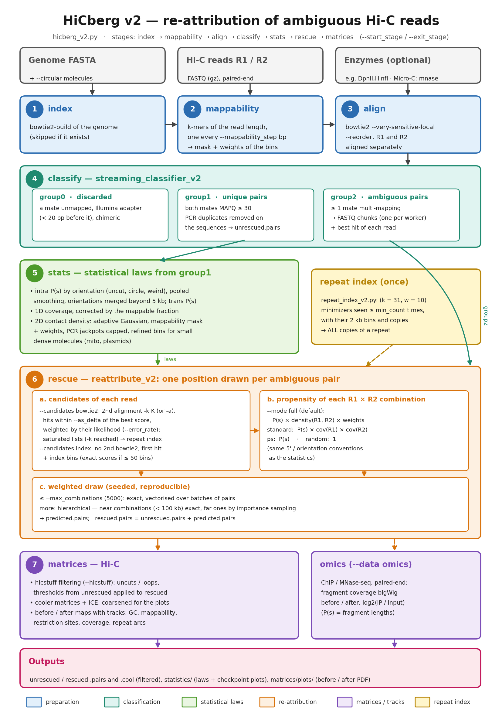

# HiCberg Human-Scale — Development Notes

## Pipeline overview



*One-page diagram of the v2 pipeline (PDF: `figures/hicberg_v2_pipeline.pdf`; regenerate with `python3 docs/figures/make_pipeline_figure.py`). Updated 2026-11-20.*

## Context

HiCberg is a pipeline to rescue multi-mapping reads in Hi-C / Micro-C data.
The current version works well on small genomes with low repeat copy numbers (~50).
This development branch targets **human genome scale** with:
- Near-T2T diploid assembly of GM12878 (Platinum Pedigree, AWS)
- Micro-C data from GM12878 (Dovetail 800M reads or Cleopatra ultra-deep)
- Repeat elements with thousands of copies (LINE-1, Alu...)
- bowtie2 alignment with k=100

---

## Architecture decisions

### Reference genome

- **GM12878 near-T2T diploid phased assembly** (Platinum Pedigree CEPH 1463 consortium)
  - Available on AWS Open Data: `s3://platinum-pedigree-data/`
  - ~63.3% of chromosomes are near-T2T for generations G1-G3
  - Used in CiFi (Nature Communications 2025) for phasing long-read chromatin data
- Alternative for development/testing: **T2T-CHM13v2.0** (GCA_009914755.4)
- For validation: **yeast genome** (small, well-annotated, known P(s) curves)

---

## Pipeline overview (v2 branch)

```
FASTQ_1  FASTQ_2
   |         |
   ▼         ▼
bowtie2 --very-sensitive-local --reorder (NO -k, NO trim)
   |         |
   ▼         ▼
 1.sam     2.sam
      \   /
       ▼ ▼
  streaming_classifier_v2.py
       |
  ┌────┴─────────────┐
  │                  │
group0            group1              group2
unmapped       unrescued.pairs    group2_1_chunk{i}.fastq
names.txt      (pairtools fmt)    group2_2_chunk{i}.fastq
                     |            chimeric_names.txt
                     ▼                 |
             statistics_v2.py          ▼
         P(s), trans P(s), coverage   bowtie2 -k 100 --very-sensitive-local
         (density: TODO)              (pipe stdout → never written to disk)
                     |                 |
                     ▼                 |
           plots/*.pdf (plots_v2.py)   |
                     |                 |
          ══ CHECKPOINT: check the ══  |
          ══ laws, stop if wrong   ══  |
                     |                 |
                     └───────┬─────────┘
                             ▼
                     reattribute_reads()
                     (multi-scale vectorised)
                             |
                             ▼
                      predicted.pairs
```

The statistical laws are plotted as soon as they are computed (before the
re-attribution), so that a wrong signal (P(s), coverage, density) can be
spotted and the run stopped before the costly re-attribution step.

---

## Module 1: streaming_classifier_v2.py

**File:** `streaming_classifier_v2.py` (root of the `v2` branch)

### Key decisions

**Why no BAM sort:**
bowtie2 `--reorder` guarantees reads come out in FASTQ input order →
pairs are always consecutive in the SAM → no need for samtools sort.
This saves: SAM→BAM conversion + samtools sort (huge time/disk savings at human scale).

**Why no `-5 100` trim:**
Empirical test on 10,000 reads showed:
- With trim   : 2567 reads with XS (all clean repeats, 100%)
- Without trim : 5555 reads with XS → 3173 repeats (57%) + 1344 chimeric (24%) + 1038 5'clip (19%)
The trim was eliminating 606 genuine multi-mappers to filter 1344 chimeras.
Solution: use `--very-sensitive-local` (handles soft-clipping natively) + post-alignment CIGAR filter.

**Ambiguity criterion: XS tag (not MAPQ)**
- `XS` present → bowtie2 found at least one alternative alignment → truly ambiguous
- MAPQ < 30 alone is unreliable: a uniquely-mapping read with heavy soft-clip can have low MAPQ
- With `-k 100`, MAPQ is set to 255 (undefined) → completely unusable as criterion

**Chimeric read detection:**
```python
is_chimeric = (last_cigar_op == 'S' and last_cigar_len > 30) OR (aligned_bp / query_length < 0.5)
```

**Chimeric + ambiguous reads:**
A read can be BOTH chimeric AND a genuine repeat.
→ Extract largest M block from CIGAR (regardless of position in read)
→ Send this pure chunk to group2 FASTQ for second alignment
→ Log read name in chimeric_names.txt for later processing

**Why largest M block (not 5'-most):**
- Hi-C/Micro-C ligation junction can occur anywhere in the read
- Both sides of the junction can be on a repeat
- Taking largest block maximises information for discriminating repeat copies

### Classification logic

```
pair (r1, r2)
    │
    ├─ r1 unmapped OR r2 unmapped  →  group0: group0_names.txt
    │
    ├─ XS absent on r1 AND r2      →  group1: unrescued.pairs
    │
    └─ XS present on r1 OR r2      →  group2
           │
           └─ for each ambiguous read:
                  if chimeric → extract largest M chunk (≥30 bp)
                                log name in chimeric_names.txt
                  else        → keep full sequence
           → write to group2_1_chunk{i}.fastq / group2_2_chunk{i}.fastq
```

### Position convention in unrescued.pairs

**pairtools standard:**
```python
forward (+) : pos = reference_start + 1   # 0-based → 1-based
reverse (-) : pos = reference_end          # 0-based exclusive in pysam = 1-based inclusive of last aligned base
```


**Note:** The previous hicberg version computed distances directly from BAM objects via `get_cis_distance()` + `get_ordered_reads()`, which correctly handled forward/reverse positions using pysam. In the new version, since distances are computed from `unrescued.pairs`, the correct outer-most 5' position must be encoded at write time via `get_outer_5prime()`. Both approaches give identical results — only the moment where the forward/reverse distinction is applied changes.

**Validation:** confirmed on read VH01685:169:AAFWFNHM5:1:1101:24101:27694
```
r1 flag=0  (forward) : ref_start=30108081 → pos1 = 30108082
r2 flag=16 (reverse) : ref_end=30108134   → pos2 = 30108134
distance = 52 bp  (correct fragment size)
```

### Performance

Fast path: only group2 pairs (~15%) go through the full `parse_sam_line()`
(sequence, qualities, CIGAR tuples). group0/group1 lines are split once
(tags kept unsplit), XS found by substring search, 5' position computed from
POS + CIGAR reference length. Outputs strictly identical (byte-for-byte on yeast).

| Dataset | Before | Fast path | RAM |
|---------|--------|-----------|-----|
| Yeast 10M pairs (36 bp) | 2 min 29 s | 1 min 11 s | 12 MB |
| Human 500M pairs (150 bp), extrapolated | ~2-4 h | ~1-1.5 h | ~12 MB |

Single core. Next step (pipeline level): split FASTQ into N chunks and stream
`bowtie2 | classifier` per chunk → no SAM on disk (~450 GB for human) and
time divided by N.

### Parallelisation

Group2 FASTQ is split into `n_cpus` chunks at creation time (round-robin per pair).
This replaces the BAM chunking step in the current pipeline which was slow.
Chunks are balanced by pairs (never split a pair across chunks).

### CLI usage

```bash
python3 streaming_classifier_v2.py \
    1.sam 2.sam ./output_dir \
    --n_cpus 20 \
    --min_chunk_bp 30 \
    --threshold_clip 30 \
    --min_aligned_frac 0.5
```

### Outputs

| File | Content |
|------|---------|
| `group0_names.txt` | read names with ≥1 unmapped mate |
| `unrescued.pairs` | pairtools format, group1 pairs |
| `group2_1_chunk{i}.fastq` | group2 R1, split in n_cpus chunks |
| `group2_2_chunk{i}.fastq` | group2 R2, split in n_cpus chunks |
| `chimeric_names.txt` | read names of chimeric reads sent to group2 |
| `stats.txt` | counts per group + chimeric |

---

## Module 2: statistics_v2.py (P(s) + coverage done, density TODO)

**File:** `statistics_v2.py` — tests in `tests/test_statistics_v2.py`

Single streaming pass over `unrescued.pairs` (pandas chunks + `np.bincount`).
Yeast 7.7M pairs: 8 s, 0.8 GB RAM → human ~500M pairs estimated ~10 min.
Output file names and normalisations identical to the previous version
(`xs.npy`, `uncuts.npy`, `circles.npy`, `weirds.npy`, `trans_ps.npy`,
`coverage1.npy`, `coverage.npy`) + raw counts of the 4 orientations in `ps_counts.npz`.
Smoothing reuses `fitting_ps` / `mad_smoothing2` from `hicberg.utils` (temporary dependency).

```bash
python3 statistics_v2.py unrescued.pairs ./stats \
    --chrom_sizes 1.sam          # @SQ header, or chrom.sizes / .fai
    --circular plasmid2micron \
    --bin_size 2000
```

The PDF plots of the laws are generated at the end in `./stats/plots/`
(`--no_plots` to disable).

**Conventions (must be reused by reattribute_reads):**
- distance `d = |pos2 - pos1|` on the outer 5' positions of the pairs file
  (`min(d, L - d)` on circular chromosomes), same `d` for building and lookup
- coverage bin `= (pos - 1) // bin_size`
- orientation defined after ordering reads by position (leftmost first)

**Circular chromosomes (`--circular plasmid2micron,chrMT`):**
- distance `d = min(|pos2 - pos1|, L - |pos2 - pos1|)` → `d ≤ L/2`
- normalisation: a circle has `L` position pairs at every distance `d ≤ L/2`
  (vs `L - d` for a linear chromosome) → area = `L × bin width`, 0 beyond `L/2`
- if chrMT is not declared circular, its P(s) shows an artificial upturn
  near `d ≈ L` (contacts across the origin of the linearised sequence)
- previous version: same circular distance (`classify_reads()` overwrites
  the bowtie2 `XG` tag with the chromosome length, used by `get_cis_distance()`),
  but linear trapezoid areas → v1 vs v2 P(s) differ on circular chromosomes
  by the ratio of the areas, increasingly with distance.

**Yeast check:** beyond 5 kb, the 4 orientations are at 25.0% ± 0.1% each;
below 1 kb, `+-` = 69% (dangling ends).

**Validation vs v1 (yeast AC1 10M, 2026-11-12)** — plots in
`/media/axel/EVO/data_for_v2/yeast/stats_v2/compare_v1/`:
- group1: 7,709,374 (v2) vs 7,708,946 (v1) pairs; same `xs` bins
- P(s), 16 linear chromosomes: median ratio v2/v1 = 1.000 for the 3 laws.
  Median deviation < 0.2% beyond 1 kb, 0% at all distances for circles.
- < 1 kb: distance convention. v1 used one formula per orientation + 1 when
  building (but not at lookup); vs v2: uncut offset 2 bp, weird 1 bp,
  circle 0 bp → large relative deviations only in the 1-bp-wide bins < 100 bp.
- isolated ~10% jumps beyond 1 kb: **`fitting_ps` outlier detection**
  (z-score > 1.5) flips points between versions although raw values agree
  within ~1% → unstable smoothing, likely cause of the P(s) tail fluctuations
  seen on reconstructed maps → to replace.
- coverage: +0.006% reads; v1 counted reverse reads at `reference_start`
  (v2: 5' end, which is also what v1 used at lookup) → median 0.5% per bin;
  v1 has 1 extra empty bin on some chromosomes (`round(L/bin + 1)`).
  Smoothed coverage: 45/6115 bins differ > 20%, all at chromosome ends with
  0 reads (values extrapolated by `mad_smoothing2`) → mappability mask needed.
- chrMT / plasmid2micron: median ratio 0.92-0.99, expected (circular
  normalisation, v1 used linear trapezoids).

### P(s) smoothing: `pool` (default) replaces `fitting_ps`

`fitting_ps` (LOWESS + replacement of points with |z-score| > 1.5 by the fit)
is unstable (±10% jumps for tiny input changes, see validation) and even
increases the roughness: beyond 100 kb, raw 0.084 → fitting_ps 0.094. It also
replaces points with > 1000 pairs (up to 22%). Kept as `--ps_smoothing fitting_ps`
to reproduce v1.

`pool` (`pooled_law`, `smooth_ps_laws`) — no point is ever replaced by a fit:
0. below `--ps_pool_distance` (1 kb, same limit as `fitting_ps` in v1): raw
   values, zeros and fluctuations included. The law changes from one bp to
   the next there and zeros are information (no ++/-- pair below 19 bp on
   chrI, ~12 expected with a pooled plateau). A first version pooled these
   bins → flat plateau giving a never-observed 10-bp configuration the same
   weight as d ≈ 10 kb → fixed.
1. beyond `--ps_merge_distance` (5 kb) the 4 orientations are equivalent
   (25% each, check orientations.pdf) → one law for uncut/circle/weird from
   all the pairs over 4 × area (4× more counts)
2. consecutive distance bins pooled (short → long) until ≥ `--ps_min_pairs`
   (100) pairs per group (Poisson error ≤ 10%); last incomplete group merged
   back; a rich bin alone in its group keeps its exact raw value
3. group values interpolated in log-log between group centres, then rescaled
   (3 iterations) so that each group gets exactly its observed pairs
   (Σ area × law = Σ counts). Without this, the group value (area-weighted
   mean of a decaying law) is not the law at the group centre: +15% at 10 kb,
   ×1.9 at 400 kb on simulated power laws. After: no bias (+1% ± 5% over 50 draws)
4. ends: flat before the first group centre (short distances are not a power
   law), log-log slope of the last segment beyond the last centre

Yeast AC1 (with mappability), beyond 100 kb: roughness raw 0.084, fitting_ps
0.094, **pool 0.049**; rich bins (≥ 1000 pairs) unchanged (0.0%).
The tail of small chromosomes rises (last bin / P(s) at L/2: chrI ×3.4,
chrIII ×3.3, chrXI ×2.4, most others ×1.0-1.5): present in the raw data, few
pairs; could be telomere-telomere contacts (Rabl) → to check.

### Is the trapezoid (position-pair) normalisation biased? (yeast AC1, 2026-11-13)

The area = number of position pairs at distance d gives a probability per
position pair, which is what is compared between candidates. It assumes all
positions are equivalent; general form: area(d) = Σ_i w(i) w(i+d) (FFT, same
code as the mappability mask). Two checks:

1. **Coverage autocorrelation.** With propensity = P(s) × cov(i) × cov(j), the
   consistent denominator is Σ cov(i) cov(i+d). Ratio current / coverage-weighted
   (observed group1 coverage at 100 bp, CV 0.39 vs Poisson 0.09), normalised
   on 10-100 kb: current P(s) overestimated by **6% at 100 bp, 5% at 200 bp,
   1% at 500 bp, < 0.3% beyond 1 kb** (16 chromosomes, max 7%). Negligible
   compared with the 5 orders of magnitude of the P(s) → keep the current
   areas. To re-measure on human (CNV, GC: coverage varies at larger scales).
2. **Restriction sites (DpnII + HinfI).** 22% of read 5' ends are within 5 bp
   of a site (5.5% for random mappable positions, ×4), depleted at 5-30 bp.
   Not soft-clipped junctions (0.8% soft-clipped) → reads truly starting at a
   fragment end. But the enrichment is the **same in every pair category**
   (uncut < 1 kb 24%, 1-10 kb 22%, > 10 kb 21%, trans 22%) and identical
   between copies of a repeat (same sequence) → cancels in the P(s) shape
   and in the comparison of candidates. The (slow) restriction-site-based
   count of potential events is not needed. Its effect at short distances is
   already included in check 1.
3. **Very high P(s) at 1-3 bp (uncut +-)** come from the counts, not from the
   normalisation: genome-wide 94 / 816 / **5314** pairs at d = 1 / 2 / 3 bp,
   then ~5-15 per bp up to 30 bp. 99.3% of the d = 3 bp pairs sit on a
   restriction site: both reads start at the two 5' ends of the same cut
   site, offset by the overhang (DpnII 4 nt → d = 3; HinfI 3 nt → d = 2).
   Real (artefactual) events; for a multi-mapping pair of this kind the d = 3
   configuration has the same weight in every repeat copy → favours keeping
   both reads in the same copy. Could also be filtered upstream.

Scripts (one-off, not in the repo): `/media/axel/EVO/data_for_v2/yeast/analyses/`
(`analyse_normalisation.py`, `analyse_sites_par_categorie.py`, `analyse_softclip.py`).

### P(s) — probability of contact vs genomic distance

Computed from `unrescued.pairs` (not BAM).

**4 orientations to track separately:**

| Orientation | Name | Biology |
|-------------|------|---------|
| `+/-` inward  | is_uncut  | true Hi-C contacts → classic decaying P(s) |
| `-/+` outward | is_circle | re-ligation artefacts → peak at short distance |
| `++` same     | is_weird  | artefacts |
| `--` same     | is_weird  | artefacts |

**Important:** do NOT filter artefacts before reconstruction.
P(s) must be computed on ALL pairs (artefacts included) so that the
reconstructed group2 carries the same biases → filter AFTER reconstruction.

**Distance calculation:**
The previous version computed a different formula per orientation from BAM
coordinates (`get_cis_distance()`). In v2, `pos` in the pairs file is already
the outer 5' position of each read, so a single formula covers all cases:
`d = |pos2 - pos1|`. It differs from the old one by at most ~2 bp (for `--` pairs,
the old code used `reference_start` → differs by the difference of the two
aligned lengths).
Short distances are real biological artefacts (dangling ends, re-ligations),
not calculation errors.

### Density map: density_v2.py (step 1 done: v1 reproduced)

v1 (`get_local_density`, per chromosome pair, 2 kb, from the **unbalanced**
cooler): bad bins of the balancing → NaN; intra: obs / mean of the *positive*
values of each diagonal (≥ 10 → 1); trans: obs / block mean; zeros → 1;
NaN filled by nan-mean 15×15 (5 iterations); nan-mean 45×45; diagonal → 1.

v2: same algorithm, from the pairs file, with nan-mean windows computed as
`uniform_filter(values) / uniform_filter(defined)` (identical to v1's
`generic_filter` + Python callback, tested; O(1) per pixel).
- contact matrix built from v1's `unrescued.pairs` = v1 cooler, pixel by
  pixel (bin = (pos - 1) // bin_size, as `cooler cload pairs`)
- density with v1's mask: **identical to v1's density_map.npy** (max abs
  difference 1.3e-14 over the 171 blocks), **1.8 s** vs ~2 min (8 cores)

**Bias found in v1 (yeast AC1):** intra density is almost flat (5-95%:
0.93-1.07), but **trans median = 1.84**. Cause: zeros → 1 is not neutral on
sparse blocks. ~87% of trans pixels are 0 at 2 kb; after obs / mean the
non-zero pixels average 1 / 0.13 ≈ 7.5, so replacing zeros by 1 gives a mean
≈ 1 + 0.87. In mode `full` (P(s) × density) trans candidates are favoured
~×1.8 over intra ones, and the factor depends on the sparsity (depth,
resolution): close to ×2 for human at 2 kb. Intra avoids it only because the
expected is the mean of the positive values (zeros excluded), which in turn
erases real depletions.

**Use:** mode `full` = P(s) × density only (no coverage: the density is
computed on the unbalanced matrix, so it already contains the 1D effects).
For yeast its main role is the centromere clustering in trans (a read is
more likely to come from a centromere than from the middle of an arm).

**Step 2 (yeast AC1)** — `density_v2.py --method unbiased`: zeros kept as 0,
expected = diagonal mean (intra) / block mean (trans) zeros included, no cap.
Mask = mappability (`coverage_kept.npy`, 622 bins) instead of the balancing
(522 bins). Medians over the 120 pairs of nuclear chromosomes:

| version | median intra | median trans | CEN-CEN | CEN / trans median |
|---|---|---|---|---|
| A v1 (file) | 1.00 | 1.84 | 5.62 | 3.06 |
| B v2 pairs + mappability mask + v1 method | 1.00 | 1.84 | 5.67 | 3.08 |
| C v2 pairs + mappability mask + unbiased | 1.02 | **0.95** | 5.10 | **5.34** |
| raw counts, same 45×45 window | | 1.00 | 5.20 | |

The mask changes almost nothing; the unbiased obs / exp gives a neutral
trans background and the raw centromere contrast. Smoothing window
(unbiased): CEN-CEN density = raw enrichment at every scale, but the peak is
sharp: ×24.8 at 10 kb, ×16.7 at 22 kb, ×10.0 at 42 kb, ×7.2 at 62 kb, ×5.1
at 90 kb (v1 window). Noise on the arms (CV): 0.58 / 0.36 / 0.28 / 0.24 /
0.22, Poisson part 0.53 / 0.24 / 0.13 / 0.09 / 0.06 (the rest is real
structure).

**Adaptive window** (`--smoothing adaptive`, default): for each pixel, the
smallest window among 1/3/5/11/21/31/45 bins (2-90 kb; 1 and 3 added later, see
below) holding ≥ `--n_min` raw contacts, nan-mean of obs / exp over it. Yeast
(first version, windows 5-45):

| smoothing | trans median | CEN-CEN | arm noise (CV) | window CEN / arms |
|---|---|---|---|---|
| fixed 45 | 0.95 | ×5.1 | 0.22 | 90 kb / 90 kb |
| adaptive n_min=50 | 0.95 | ×24.8 | 0.25 | 10 kb / 42 kb |
| adaptive n_min=100 | 0.95 | ×16.9 | 0.23 | 22 kb / 62 kb |
| **adaptive n_min=200** | 0.95 | **×16.5** | 0.22 | 22 kb / 90 kb |

Centromere peak 3.3× sharper (= raw ×17.1 at 22 kb) with the same arm noise;
4.3 s for the genome.

Are the fine fluctuations real? Split-half test: pairs split at random in two
halves, fluctuations = log2 adaptive − log2 fixed 45 computed on each half
(same windows as the full map), correlation between halves (→ reproducible
part of the full map by Spearman-Brown 2r/(1+r)):

| zone | n_min=100 | n_min=200 (default) |
|---|---|---|
| intra 6-100 kb | 0.78 (≈ 88%) | 0.83 (≈ 91%) |
| intra 100-400 kb | 0.49 (≈ 66%) | 0.54 (≈ 70%) |
| trans | 0.45 (≈ 62%) | 0.84 (≈ 91%) |

→ n_min = 200: same centromere peak, fluctuations ~90% real.

**Threshold choice.**
- A cross-validation criterion (density of one half predicts the counts of
  the other, Poisson deviance) chose n_min 100 intra / 50 trans: sharper
  (trans centromere ×24.6) but visibly noisier (only ~50% of the extra trans
  fluctuations real) → rejected.
- **`--density_n_min auto`** (`density_v2.reproducible_n_min`): smallest
  n_min, separately intra and trans, whose fine fluctuations (log2 adaptive −
  log2 45-bin window, on each of two random halves of the pairs, halves at
  n_min / 2) are reproducible: part = 2r / (1 + r) ≥ `--density_reproducibility`
  (default **0.8**); grid 25/50/100/150/200/300/400. Recomputed per dataset:
  deeper data or stronger structure → lower threshold, finer maps.
  Yeast (intra pixels ≥ 3 bins from the diagonal):

  | n_min | 100 | 150 | 200 | 300 | 400 |
  |---|---|---|---|---|---|
  | intra | 71% | 76% | 79.5% | **85%** | 88% |
  | trans | 62% | 79% | **91%** | 97% | 98% |

  → intra 300, trans 200. Without `auto`: 200 / 200
  (`--density_n_min`, `--density_n_min_trans`). Cost of `auto` on yeast:
  whole statistics step 153 s, 3.6 GB RAM (65 s without). Human: calibrate on
  a subset of chromosomes (step 3). The intra value is dominated by the far
  pixels (most numerous); a per-distance-band threshold would be possible.
- **Windows of 1 and 3 bins** added: the window is already chosen pixel by
  pixel, and near the diagonal 1-3 bins hold enough contacts (chrIV,
  n_min 200: 3×3 enough for 95% of pixels at 2-4 kb, 92% at 4-10 kb, 46% at
  10-20 kb; 1×1 for 30% at 2-4 kb) → 2-6 kb resolution along the diagonal,
  unchanged beyond ~20 kb.
Intra (v1 almost flat, 5-95%: 0.93-1.07): the adaptive map shows the Rabl
X pattern centred on each centromere, the rDNA separation on chrXII and
local structure near the diagonal (correlation with the raw obs / exp 0.31-0.41
vs 0.20-0.22 for v1). Yeast has no real TAD at 2 kb: domains to check on human.
Square textures = shape of the box windows around isolated high pixels
(not the filled bad bins); Gaussian windows would round them (optional). Maps also show the isolation of the rDNA
(chrXII) in trans (low density band), hidden by the inflated v1 background.

**Mappable-length weights** (`--mappability stats/mappability.npy`):
expected(i, j) = E_d × w_i × w_j with w = mappable length / bin_size, E_d =
Σ obs / Σ w_i w_j on each diagonal (trans: on the block). Same logic as the
P(s) areas and the coverage. End of chrI: the last bin (490 bp, 431 bp
mappable) had obs / exp 0.14 only because of its size, and pulled the fill
of the 26-kb unmappable subtelomere down to 0.77; with the weights the end
stays at 0.95-0.97. Elsewhere: median |Δ log2| 0.009 (99%: 0.08), CEN-CEN
×16.3. w = 1 → identical to the unweighted computation (tested).

```bash
python3 density_v2.py unrescued.pairs ./density --chrom_sizes 1.sam \
    --mappability ./stats/mappability.npy \
    --coverage_kept ./stats/coverage_kept.npy      # unbiased + adaptive (default)
# v1: --method v1 --smoothing fixed --bad_bins_cooler unrescued.pairs.cool
```
`plots_v2.plot_density()` → `density.pdf` (genome log2 map + zooms, side by side).

**In the pipeline:** `statistics_v2.py` now computes the density by default
(unbiased, adaptive window, n_min 200 / 200 or `auto`, mappability mask and
weights when `--mappability` is given; `--no_density`, `--density_n_min`,
`--density_n_min_trans`, `--density_reproducibility`), saves
`density_map.npy` and `contacts.npz` (contact matrix at bin_size, upper
triangle), and the checkpoint plots include, for each chromosome
(`density_intra.pdf`) and each pair of chromosomes (`density_trans.pdf`, ≤ 200
pairs), the raw obs / exp (not smoothed, same mask and weights; 2 kb intra,
sum obs / sum exp over 5×5 bins = 10 kb in trans where 2-kb pixels hold 0 or 1
contact; log2 ±3) next to the density (log2 ±1.5), real proportions, axes in
kb, one colour bar each. Grey = excluded bins, darkest blue = zero contact. Yeast: whole
statistics step with density and plots 65 s, 1.6 GB RAM. Human: contacts.npz
and per-pair pages to rethink with the banded storage (step 3).

Coverage: low-coverage mappable bins are now **kept** by default
(`--coverage_min_ratio 0`): a low coverage can be real (e.g. few restriction
sites) and must be reconstructed faithfully; filtering / normalisation come
after the reconstruction.

Interpolation anchors: only bins with ≥ half a bin of mappable bp. End of
chrI: the last bin (490 bp, 88% mappable) is really under-covered (706 R1
reads / 2 kb of *all* aligned reads, vs ~1580 on the arm; only 9% with XS:
chromosome-end effect, not ambiguity). Used as an anchor it pulled the 26 kb
of interpolated subtelomere (bins 102-114) from 2062 down to 912, whereas all
the aligned reads (ambiguous ones included) show ~0.75× the arm level there.
Now it keeps its own value (823) and the gap stays at 2062.

**Option: unmappable bins from all aligned reads.** `streaming_classifier_v2.py
--coverage_all_reads` (+25% time: 71 → 89 s on yeast) saves the 5' positions
of all aligned reads in 100-bp bins (`coverage_all_reads.npz`); an ambiguous
read is counted at the position bowtie2 reported, chosen at random among its
best alignments, so each copy of a repeat gets its share on average.
`statistics_v2.py --coverage_all_reads coverage_all_reads.npz`: excluded bins
= all-reads coverage × (median group1 / all-reads ratio on fully mappable
bins, 0.92 on yeast). Excluded bins / chromosome median: interpolation 0.88
(Q5-Q95 0.71-1.11), all reads 0.95 (0.51-1.42). Default stays interpolation.

Step 3: human scale (banded intra at fine resolution, coarse trans).

### Coverage (smoothed 1D)

- Computed per chromosome from group1 alignments
- Bin size: TBD (current code uses 2 kb)
- Smoothing: Gaussian (as in current code)
- Storage: numpy array per chromosome

### Density map (2D)

- For human genome: 23×23 = 529 sub-matrices
- Strategy: `np.memmap` shared between workers to avoid RAM explosion
- Computed by diagonal bands (intra-chromosomal contacts dominate)
- LRU cache for repeated lookups on same bin pairs

### Plots: plots_v2.py

Multi-page PDFs (one page per chromosome) from any statistics folder (v1 or v2,
same file names). `--compare_dir` overlays a reference folder (previous version).

```bash
python3 plots_v2.py ./stats                              # v2 only
python3 plots_v2.py ./stats --compare_dir old/statistics # v2 vs v1
```

| File | Content |
|------|---------|
| `ps.pdf` | P(s) uncut / circle / weird, log-log (v1 as lines if compared) |
| `ps_ratio.pdf` | P(s) ratio v2 / v1 per chromosome + summary page (median ratios) |
| `orientations.pdf` | fraction of +-, -+, ++, -- vs distance (should reach 25% each) |
| `coverage.pdf` | raw + smoothed coverage |
| `trans_ps.pdf` | trans P(s) heatmap (+ scatter v2 vs v1) |

### Mappability: mappability_v2.py (P(s) done, coverage/density TODO)

```bash
# once per genome and read length (yeast: 10 s, 100 MB RAM)
python3 mappability_v2.py genome.fa ./mappability -K 35 -E 2 -T 8
python3 statistics_v2.py unrescued.pairs ./stats ... \
    --mappability ./mappability/genmap_K35_E2.bedgraph   # --map_resolution 100
```

- mask = per bin, **fraction of positions whose k-mer is unique**
  (GenMap score ≥ `--min_mappability`, default 1). Not the mean score: a read
  from a 2-copy position has an XS tag → group2 → never observed in group1.
- P(s) area = number of pairs of mappable positions per distance bin =
  autocorrelation of the mask (FFT, `--map_resolution` 100 bp; human chr1 →
  2.5M points). Mask = 1 everywhere → exactly the trapezoids (tested).
  `C[0] = Σ f` (a position paired with itself), circular autocorrelation
  for circular chromosomes.
- trans P(s): `contacts / (4 × mappable L1 × mappable L2)`
- `mappability.npy`: mask at the coverage bin size (2 kb), plotted with the
  coverage (grey, right axis)

**Yeast AC1 (K=35, E=2): 91.6% of the genome mappable.**
- P(s) level × 1.04 (chrXI) to × 1.40 (chrI): the trapezoid underestimated
  the P(s) differently on each chromosome (chrI: small, large subtelomeric
  repeats) → matters for re-attribution between chromosomes.
- roughness of raw log P(s) beyond 100 kb (std of second differences):
  0.131 → 0.064, Poisson counting noise = 0.053 → most chromosomes are now at
  the noise floor (chrI 0.68 → 0.13, chrXVI 0.17 → 0.04). Still above: chrXII
  (rDNA), chrX, chrXI, chrIII.
- coverage: unmappable bins = coverage drops (subtelomeres); `mad_smoothing2`
  extrapolated over them, and even produced **negative coverages** (down to
  -5923 on chrVIII, line fitted on a few neighbours and extended).

**Coverage with mappability (`correct_coverage`)**, replaces `mad_smoothing2`:
1. corrected = raw × 2000 / (fraction × effective width): the last, shorter
   bin of each chromosome is scaled, not excluded
2. bin kept if fraction (of its own width) ≥ 0.8 (`--coverage_min_fraction`)
   and ≥ 100 mappable bp (`--coverage_min_bp`, guard against tiny remnants)
3. low outliers excluded: corrected < 0.5 × median of the 10 closest kept
   bins on each side (`--coverage_min_ratio`; closest *kept* bins, so that
   an isolated bin after an unmappable stretch is not compared to itself)
4. excluded bins: linear interpolation between kept bins (periodic if
   circular, constant beyond the ends) → never negative

Yeast: 632 / 6139 bins excluded (10%); final coverage / chromosome median
between 0.45 and 1.75, no negative value. `coverage_kept.npy` = bins kept,
shown in blue (kept) / red (excluded) on the coverage plots.
Check: coverage ∝ mappable fraction holds for fraction ≥ 0.6 (ratio 0.92-1.00),
not below 0.2 (median 0.37).

---

## Pipeline CLI: hicberg_v2.py

```bash
python3 hicberg_v2.py genome.fa R1.fq.gz R2.fq.gz -o out --cpus 16 \
    --circular plasmid2micron,chrMT --max_alignments all \
    --hicstuff --enzyme DpnII,HinfI          # [--index existing_prefix]
# checkpoint: --exit_stage stats, check out/statistics/plots, then --start_stage rescue
```

Stages: `index` (bowtie2-build unless `--index`) → `mappability` (k = read
length read from R1; `--mappability bowtie2` (default) | `genmap` | `none` |
path of a bedgraph; + repeat links, `--repeat_links_step`) → `align` (bowtie2
--very-sensitive-local --reorder, SAM deleted after classify unless
`--keep_sam`) → `classify` → `stats` (+ checkpoint plots) → `rescue` →
`matrices`. Chromosome sizes from the FASTA (`out/chrom.sizes`).
Group2 chunks = cpus / 4, re-aligned and re-attributed in parallel.

**matrices_v2.py** (last stage):
- `--hicstuff`: hicstuff filtering (as `hicstuff pipeline --start-stage=pairs
  --filter --duplicates`) on unrescued.pairs and rescued.pairs (non-informative events: uncuts,
  loops, weirds; PCR duplicates), in `matrices/hicstuff_<prefix>/`.
  Needs the 4DN pairs header: columns **chr1 / chr2** (our first files used
  chrom1 / chrom2: pairtools sort failed and the PCR-free file was empty) and
  `#chromsize` lines → fixed in the classifier and reattribute_v2.
  Yeast group1: 1.81M pairs discarded (uncuts 1.39M, loops 0.41M, weirds
  10.5k), 5% PCR duplicates, 5.59M remaining; 5.5 min.
  **Same thresholds for both files:** hicstuff estimates its uncut / loop
  thresholds per library; on yeast it chose 19 / 25 fragments on unrescued
  but 8 / 10 on rescued, so the rescued pairs were less filtered (1.23M uncuts
  removed vs 1.39M from a file they contain) and before / after was biased.
  Now the thresholds estimated on unrescued are applied to rescued.
  **hicstuff library calls instead of `hicstuff pipeline`** (2026-11-16): the
  pipeline always built its own cooler matrix, unused here (~15 min per file
  on the 47 M pairs of full AC1). `hicstuff_filter` now calls the same steps
  one by one: `digest.attribute_fragments`, `io.sort_pairs`,
  `filter.get_thresholds` (unrescued) / given thresholds (rescued),
  `filter.filter_events`, `pipeline.filter_pcr_dup` (events filtered before
  duplicates, as hicstuff). Checked on 1.5 M yeast pairs: same thresholds
  (19 / 22) and identical 1,130,918 output pairs, 45 s vs 82 s. Micro-C
  (`--enzyme mnase`, or a number): hicstuff fixed-size digestion into virtual
  fragments (100 bp by default), so that uncuts / loops / weirds between
  neighbouring segments are filtered as with a frequent cutter, then PCR
  duplicates.
- cooler matrices at bin_size (`cooler cload pairs`) + ICE (`cooler balance`),
  mad-max 5 for unrescued, 1000 for rescued (as v1: the reconstructed repeats
  must not be filtered out again).
- `plot_before_after`: v1-style pages (hicberg/plot.py plot_matrix), one page
  per pair of chromosomes (intra only if > 30 chromosomes or `--intra_only`),
  `matrices_raw.pdf` and `matrices_normalised.pdf` (ICE): left unrescued map
  + GC, **Mappability** (shorter track); right rescued map + coverage before / after (median
  of before dashed, legend outside on the right), **number of Hi-C restriction
  sites per bin** (bars, `--enzyme`, e.g. DpnII + HinfI; GC for Micro-C): the
  bins that stay poor in reads after rescue are bins with few sites (yeast,
  2 kb: bins with 0-5 sites have 0.49× the median coverage; the 11 bins below
  25 % of the median have 0 site, vs 12 for a typical bin; Spearman 0.46).
  Intra colour scale (raw and ICE): log10 from the 1st percentile of the non-zero
  pixels lowered by 0.5 × the fraction of empty pixels (sparse yeast 2 kb maps,
  60-70 % empty: ≈ -0.33 in raw; dense chrMT: tight scale, ≈ -2.4 to -0.7 in
  ICE as in v1; a fixed offset of 1 washed the far field into orange) to the
  99.97th percentile (95th / 99th / 99.9th
  saturated the first diagonals, the max depends on outlier pixels). At 2 kb
  most non-zero raw pixels hold a single contact (log10 = 0): with vmin = 0
  (v1) they were white like the empty pixels and the far field / domains
  vanished; the v1 vmax 3.5 also washed the maps out. Trans: raw 0-99.5th
  percentile, ICE 5th-99th. Tracks without top / right frame; titles give the number of
  contacts of each block (upper triangle in intra). The normalised
  maps remove the copy-number effect (rDNA, 2µ) that dominates the raw ones.

## Module 3: reattribute_v2.py (first version done)

```bash
python3 reattribute_v2.py classifier_dir stats_dir out_dir --index genome_index \
    --mode full --max_alignments all --n_workers 4 --threads 4   # yeast: -a
```

1. per group2 chunk: `bowtie2 --very-sensitive-local --reorder -k K` (or `-a`,
   `--max_alignments all`, used for yeast) on R1 and R2, stdout read as a
   stream (no SAM on disk), alignments grouped by read.
2. **candidates weighted by their likelihood**: alignments within `--as_delta`
   (30) of the best AS, weight exp(−λ (best AS − AS)), λ = ln(3(1−e)/e) / 8
   per AS point (a high-quality mismatch costs 8 points in local mode),
   `--error_rate` e = 0.01 → λ = 0.71, 1 mismatch = ×1/297; e = 0 → best-score
   alignments only. v1 kept all the -k alignments with the same weight (~26%
   of them score ≥ 1 mismatch below the best on yeast).
   History: a first v2 kept the **best-score alignments only**. It created
   artefactual trans spots with the rDNA (chrXIV 415 kb ×7.7 v1, chrXIV 359 kb
   ×7.6, chrIV 1365 kb ×4.4, chrIV 685 kb, chrVIII 564 kb), partners piled up
   within a few bp: **poly-T reads** (no positional information; 1 perfect
   locus, 230-460 loci at 1 mismatch / 1 clipped base) all sent to the same
   longest poly-T tracts. With 300 near copies at ×1/297 each, the perfect
   copy should get ~50% only: the likelihood weighting does that. Spots after
   weighting: 99 / 197 / 103 / 88 / 83 contacts (best-only 525 / 506 / 346 /
   203 / 168, v1 68 / 67 / 79 / 60 / 55); the real 2µ ↔ rDNA contact (partners
   spread over the plasmid, copy numbers) unchanged (3462, v1 3447).
3. propensity of every R1 × R2 combination, vectorised over batches of pairs
   (combination indices with np.repeat, segmented weighted draw on a global
   cumsum), same conventions as the statistics: `random`, `ps`, `standard`
   = P(s) × cov × cov, `full` = P(s) × density. Seeded draw (one seed per chunk).
4. `predicted.pairs` = unrescued.pairs format + n_candidates1/2.

**Yeast AC1, mode full, -a, likelihood weighting:** 1,524,893 group2 pairs,
all placed, 10.2 / 10.5 candidates per read, 101 combinations per pair, 70.8%
intra (group1 cis: 69.9%), **2 min 54 s** with 4 workers × 4 threads.
Unmappable bins reconstructed at 0.94 × the mappable level (0.93 expected);
predicted-only map vs group1 on mappable pixels: intra 0.544, trans 0.208.
(The numbers below were measured with the first, best-only version.)

Validation vs v1 (same read placed: same chromosome, ±50 bp, both reads):
34% overall (random draws among several candidates: 1×1 68.5%, 2-4 57%,
5-50 20%, > 50 10%). For pairs with a single best combination in v2, v1
places **17.6% of the reads on a copy with a worse score** (median gap 8 ≈
1 mismatch) → 1 − 0.824² ≈ 32% of these pairs differ: the best-score filter
fixes a v1 defect.
Coverage reconstructed (group1 + predicted) in the unmappable bins / median
of the mappable bins of the chromosome: **0.94** (v1 0.95), expected from all
the aligned reads 0.93. chrI subtelomere (bins 102-114) filled with the same
bin-by-bin profile as all the aligned reads.

`rescued.pairs` = unrescued + predicted (written by reattribute_v2).
`plots_v2.plot_contact_maps`: maps side by side (whole genome 20 kb, each
chromosome, zoomed regions), shared colour scale, with a track under each
map: mappability under the first one, coverage before (grey) / after (red)
under the others (y axis 1.5 × 99th percentile: the rDNA peak, 30-40k reads
per 2-kb bin = ~150 copies collapsed on the assembly, is clipped).
Yeast: rDNA, subtelomeres, mating-type cassettes and Ty elements, white
before, are filled; v1 and v2 similar at map scale.

**Modes full vs standard (yeast):** per-pair agreement is not a valid
comparison: two `full` runs with different seeds agree on 42.8% of the pairs
only (random draws among candidates), and full / standard run with the same
seed share their random numbers (78%, inflated). Fidelity to the 2D
organisation instead: Spearman correlation at 20 kb between the map of the
predicted pairs alone and the group1 map, on pixels whose two bins are ≥ 90%
mappable: **full intra 0.540, trans 0.203**; standard 0.519 / 0.145 (seed
noise ~0.002). The density brings the trans organisation (centromere
clustering) that the coverage product cannot → keep `full` as default.

Next: human scale.

### (initial design notes)

### Context

With k=100: max 100×100 = 10,000 combinations per block.
Real problem: millions of blocks to process.
Mode: `full` = ps × density

### Multi-scale filtering strategy

```
Block of ambiguous reads (N_for × N_rev ≤ 10,000)
        │
  FILTER 1 — Chromosomal  O(N+M)
  Eliminate trans pairs with P(trans) ≈ 0
        │
  FILTER 2 — Low-resolution coverage  O(N'+M')
  Coarse bins (50 kb): keep top-K candidates per arm
        │
  FILTER 3 — Vectorised numpy  O(N''×M'')
  ps × density as np.outer on survivors
  Weighted random draw
        │
  Selected read pair → predicted.pairs
```

### Vectorisation of propensities

```python
# Coverage: outer product → N×M matrix in one operation
cov_for = np.array([coverage[c][b] for c, b in zip(for_chroms, for_bins)])
cov_rev = np.array([coverage[c][b] for c, b in zip(rev_chroms, rev_bins)])
cov_matrix = np.outer(cov_for, cov_rev)

# P(s): group by chromosome pair, then vectorise per group
# → avoids looping over all N×M combinations
```

---

## Validation strategy

1. Run new pipeline on **yeast** (10M reads, known results)
2. Compare P(s) curves: new vs old pipeline
3. Compare density maps: new vs old pipeline
4. Compare rescued contact matrices on repeat regions
5. If validation passes → run on human GM12878 Micro-C

### Test data locations

```
tests/data/yeast/
    1.sam                   # 10M reads R1
    2.sam                   # 10M reads R2
    expected/
        unrescued.pairs     # from current hicberg pipeline
        ps_curve.npy        # reference P(s)
        density_map.npy     # reference density

tests/data/human/
    chr21_1.sam             # reduced dataset for development
    chr21_2.sam
```

---

## Environment

- OS: Linux Mint (Debian/Ubuntu based)
- Python: via conda (base environment)
- Key dependencies: pysam, numpy, scipy
- Alignment: bowtie2
- Reference: T2T-CHM13v2.0 (GCA_009914755.4) for development,
             GM12878 near-T2T for final benchmark

---

## Git workflow

```
main branch          → current hicberg (untouched)
v2 branch            → this development (human-scale)
```

Commit convention:
```
[classifier] fix chimeric chunk extraction
[stats] add P(s) by orientation
[rescue] vectorise propensity computation
[test] validate on yeast 10M reads
```

---

## Open questions / TODO

- [ ] Validate streaming_classifier_v2.py on 10M yeast reads
- [ ] Decide bin size for coverage (keep 2kb or change?)
- [ ] Decide P(s): 4 separate curves or 1 global + orientations as QC?
- [ ] Handle multi-chunk reads (2 M blocks) → saved in multi_chunk.bam for later
- [ ] Score gap threshold for XS: use AS-XS gap to reclassify some ambiguous as unique?
- [ ] Benchmark reattribute_reads on chr21 before full human genome
- [x] Theoretical mappability (GenMap) for the P(s) normalisation (mappability_v2.py)
- [ ] Mappability for the coverage (correct by mask fraction, unmappable bins
      interpolated?) and the density map (was implemented in v1 locally, Nov 2026,
      lost before being pushed)
- [x] Replace `fitting_ps` (unstable outlier replacement) → `--ps_smoothing pool`
      (default), see "P(s) smoothing" in Module 2


### Full AC1 run (47.3 M pairs) and the chrII right end (2026-11-16)

Full AC1 (AC1.end1/2.fastq.gz, 47.3 M pairs, 16 CPUs): 89.9 min (old
`hicstuff pipeline` call, ~27 min per file lost on the unused hicstuff
matrix). group0 7.8 %, group1 77.0 %, group2 15.2 % (7.2 M pairs, all placed,
70.8 % intra, 13.4 min). hicstuff thresholds 12 / 15; final matrices 23.7 M
(unrescued) vs 29.7 M (rescued) contacts. Weirds 357 k in rescued vs 50 k in
unrescued (same excess as on 10 M reads, still to explain).

chrII right end under-covered after rescue: in the T2T BY4742 assembly the
last ~25 kb (796.9-822.3 kb) are an inverted duplication of themselves (two
~12.5 kb arms centred at ~808.9 kb; 200 bp probes at 800 / 805 / 812 / 818 kb
have a perfect reverse copy at 817.9 / 812.9 / 805.9 / 799.9 kb). Mappability
~0, so no unrescued reads; after rescue each arm gets 0.45-0.65× the genome
median (unique flank 744-794 kb: ~1.0×), i.e. ~1× in total: AC1 most likely
carries one copy only (this chrII is 822,297 bp vs 813,184 in S288C R64), and
the rescue shares its reads between the two reference copies. Decision: no
copy-number correction for now; the coverage track (before / after) is
enough to warn the user that the assembly may have a different copy number
than the sample (the opposite of the rDNA case).

### Bug: group2 reads lost their strand (excess of weirds in rescued) — fixed

The excess of hicstuff "weirds" in rescued (357 k vs 50 k on full AC1;
83 k vs 10.5 k on 10 M) came from the classifier: for a read aligned on the
reverse strand, SAM SEQ / QUAL are reverse-complemented / reversed, and the
group2 FASTQ was written from them as is. At the re-alignment every read was
back on the + strand: in predicted.pairs all the reads with a single
candidate were "+", and the pairs were 5.34 M ++, 0.85 M +-, 0.85 M -+,
0.16 M -- (short-range same-strand pairs ×4 more frequent than opposite,
vs ×0.28 in unrescued; half of them in the rDNA). Reverse reads were also
placed at their alignment start instead of their 5' end (shift ≤ read
length, 35 bp: negligible at 2 kb, but the hicstuff event filtering of
rescued was wrong). Fix: `original_orientation()` puts the read back as
sequenced before writing the FASTQ. Checked on 50 k pairs of AC1: after
re-alignment the 2,325 group2 R1 reads that were unique all come back on the
same strand and position. The rescued results above (maps, fidelity,
modes) used the wrong strands; at 2 kb they are barely affected, but the
pipeline must be re-run from the alignment (SAMs not kept).

### Mappability with bowtie2 (GenMap optional) and repeat links (2026-11-16)

GenMap is no longer actively developed: the default mappability is now
computed with the aligner of the pipeline (`mappability_v2.bowtie2_mappability`).
One k-mer (k = read length) every `step` bp (default 10) is aligned with
bowtie2 --very-sensitive-local, streamed (stdin / stdout, no file); a k-mer is
mappable if it aligns without XS tag, i.e. exactly the criterion that sends a
read to group1. Bedgraph with score 1 over [p, p + step): same format as the
GenMap one, read by `binned_unique_fraction`. Options: `--mappability
bowtie2|genmap|none|<bedgraph>`, `--mappability_step`.

Yeast (k 35) vs GenMap K35 E2: mappable fraction 91.29 % vs 91.55 %; 2 kb
bins r = 0.999 (21 / 6139 bins differ by > 0.1, all on chrMT: AT-rich, local
mode finds partial second alignments → XS, as for the real reads); 100 bp
bins r = 0.994. Step 10 vs step 1: r = 1.0000 at 2 kb, no bin differs; 34 s
vs 314 s (6 threads). Mouse benchmark (mhaESC T2T, 2.87 Gb, 1 M random
k-mers, machine loaded): k 35 → 55 k k-mers/s (8 threads), k 100 → 15 k/s
(8 threads), 21 k/s (16 threads); whole genome at step 10: ~1.5 h (k 35),
~2.5-4 h (k 100), once per genome and read length. Note: in local mode 36 %
(k 35) but 43 % (k 100) of the mouse k-mers have an XS: a partial hit in a
repeat (Alu / LINE) is enough. For human Micro-C a large part of the reads
will go to group2; a threshold on AS - XS may be needed.

**Repeat links** (`mappability_v2.repeat_links`): one k-mer every 50 bp
aligned with bowtie2 -k 100; copies with AS >= best - 8 (≤ ~1 mismatch); for
a k-mer with 2-99 copies, a link from its 1 kb bin to the bin of each other
copy, with the relative orientation (+ direct / tandem, - inverted); k-mers
with >= 100 copies are saturated (not linked). First with -k 20: the Ty
elements of the chrXII right arm (614 / 672 / 840 kb: 37-40 copies per
k-mer) were saturated and had no arc → -k 100. TSV
`repeat_links_K{k}_S{step}.tsv` (chrom1 start1 chrom2 start2 orientation
n_kmers). Yeast: 3 s; 245 k k-mers, 19.3 k linked, 353 saturated; rDNA
links "+" with the 9.1 kb period, chrII right end "-" (500 / 506 k-mers:
the palindrome). **Families** (`repeat_families`, at the bin size of the
maps): graph bins ↔ links (≥ 3 k-mers, weighted by the shared k-mers),
Louvain communities (networkx, seed 0; connected components as fallback:
with -k 100 they chained Ty and subtelomeres into one family of 506 bins),
ranked by size, described automatically: tandem (one chromosome, compact),
subtelomeric (≥ 60 % of the bins within 30 kb of an end), dispersed. Yeast at
2 kb: F1 dispersed (16 chr, 120 bins), F2 / F3 subtelomeric (16 chr, 78 / 61
bins), F4-F6 dispersed (13-14 chr: Ty sub-families), F8 tandem chrXII
440-512 kb (rDNA), ...
Written to `plots/repeat_families.tsv` and `repeat_family_bins.tsv`.
Plotted as arcs left of the unrescued map, **one colour per family** (the 12
largest, others grey; the orientation stays in the links file), width ∝
sqrt(distance), line width ∝ log(k-mers), ≥ 3 k-mers per
pair of map bins, at most 3000 arcs); trans pages: ticks on a strip left of
the map (positions of the row chromosome with a copy on the column one) and
on a strip above it (positions of the column chromosome), same colours; the
maps themselves stay free of annotations (open circles at the pairs of
copies were tried and dropped). Shows at once the rDNA (tandem
cluster), the chrII palindrome, the subtelomeres (chromosome-end to
chromosome-end) and the Ty elements (long arcs).

### Large / sparse genomes: density bin, shrinkage, coverage threshold (2026-11-16)

Mosquito (Culex quinquefasciatus + Wolbachia wPipMtq, 575 Mb, 59 sequences;
library MM265a, 37 M pairs of 35 bp): only 32 % of the reads align, 85 % of
the others align on yeast (same dual index on all reads: the yeast library
probably got the same index, or yeast DNA was in the tube; to be re-run on a
mosquito + Wolbachia + yeast genome, with the yeast-mosquito chimeric pairs
as a test of when they were mixed). Wolbachia gets 23.6 % of the aligned
reads (1.4 Mb). 43.6 % of the genome uniquely mappable (k 35); group1 3.3 M
pairs (8.8 %), group2 6.6 M (17.8 %).

Scaling changes:
- `--density_bin_size` (statistics / pipeline, default auto) separate from
  the coverage bin: dense blocks of a 225 Mb chromosome at 2 kb would need
  ~1.3 TB. Memory criterion (`auto_density_bin_size`): 100 bytes per cell of
  the largest block (block_density measured ~52 bytes / cell, x2) <= half of
  MemAvailable. Density stored in float32, with its bin size
  (`density_bin_size.npy`) and its mask / mappable weights at that bin
  (`density_mask.npy`); reattribute_v2 looks the density up at its own bin.
- Before / after plots: `cooler coarsen` to `--plot_bin_size` (auto: largest
  plotted sequence <= 3000 bins: yeast 2 kb, mosquito 100 kb), sequences
  `--plot_chroms` (auto: all if <= 30, else those >= 1 Mb, at most 20);
  density plots of the statistics restricted to them and the genome-wide
  density downsampled block by block (the full matrix does not fit).
- P(s) pages of sequences without any pair are skipped (crashed on small
  unmappable scaffolds).

Problems seen on the mosquito statistics and fixes:
- Coverage: bins kept if mappable fraction >= 0.8 → only 20 % of the
  mosquito 2 kb bins (median fraction 0.44), the rest interpolated. Default
  now 0.3 (61 % kept): the coverage is already divided by the mappable
  length, a 30 % mappable bin is unbiased, only noisier.
- Density noise: 0.006 contact per far-field pixel at 25 kb (chr1), the
  45-bin window held ~12 contacts for n_min = 200; the largest-window
  nan-mean of obs / exp gave 0 and values up to 230 (stripes).
  (a) `data_density_bin_size`: from the intra P(s) counts, contact density
  per position pair rho(d) = N(d) / ((L - d) Δd); a 45 × 45 window of bins b
  holds ~ 45² rho b² contacts; smallest nice b with <= 5 % of the intra
  contacts in windows below n_min. Yeast: 0 % at 2 kb → 2 kb; mosquito:
  21 % at 2 kb, 7 % at 25 kb, 4.8 % at 50 kb → 50 kb. The density bin is the
  coarser of the memory and data criteria.
  (b) Shrinkage in `adaptive_filter` where even the largest window has
  < n_min contacts: (O + δ) / (E + δ), δ = n_min - O (the missing contacts
  are taken at density 1, i.e. P(s) only); continuous at O = n_min.
Yeast check (full AC1 unrescued, 36 M pairs): density bin stays 2 kb (0 %
fallback); kept coverage bins 5517 → 5721, coverage r = 0.997 (234 / 6139
bins differ by > 10 %, mostly around unmappable regions); density log2 r =
0.991 (intra median) / 0.995 (trans median) vs the previous maps, the
changes are in the small sparse blocks (2µ × 2µ 4 × 4 bins, chrMT trans:
shrunk towards 1).

**Telomere-telomere contacts (mosquito) — expected pooled in log distance,
larger windows.** The mosquito unrescued map at 1 Mb shows enriched
telomere-telomere contacts, absent from the density (corner ≈ 1.0). Two
causes: (1) the per-diagonal expected — the last diagonals hold a few pixels,
all near the corner, so the expected absorbs the telomere contacts (chr1
corner 3 × 3 Mb obs / exp 1.08 per diagonal, 2.10 with diagonals pooled in
log-distance groups, base 1.1 as the P(s); chr2 2.01, chr3 1.47); (2) the
largest adaptive window (45 bins = 2.25 Mb at 50 kb) holds far fewer than
n_min contacts there (the 3 × 3 Mb corners hold 146-385 contacts).
`expected_unbiased(log_pool=1.1)` (default) and DENSITY_WINDOWS extended to
61, 91, 121, 181 bins (uniform filters: cost ∝ number of windows, not their
size). Mosquito density corners (60 × 60 bins): chr1 1.02 → 2.26, chr2 1.01
→ 3.22, chr3 1.00 → 1.97; far-field median 0.98-0.99. Yeast: chromosome
maps unchanged (log2 r = 0.991 intra / 0.996 trans vs the validated maps,
changes in sparse chrMT / 2µ blocks); yeast telomere corners now visible
too (50 × 50 kb: chrXII 1.05 → 1.51, chrII 1.06 → 1.21, chrIV 1.02 →
1.06), as expected from the Rabl clustering of the telomeres.

**Adaptive Gaussian density (default).** The box windows gave square blocks
(each pixel jumps from one window size to the next). `adaptive_gaussian`:
Gaussian-like kernel (3 box passes: cost independent of the width), widths
σ = 0.5 … 90 bins (factor √2); density = smoothed observed / smoothed
expected (ratio of sums); effective contacts N_eff = smoothed counts /
Σ w² (= the count for a box); each pixel blends the two widths around
N_eff = n_min (geometric, in log N_eff): continuous, no blocks; shrinkage
towards 1 where even σ = 90 is below n_min. Compared on split halves
(n_min / 2 per half), held-out Poisson log-likelihood gain over P(s) only
(density of one half predicting the counts of the other) and split-half
correlation of the log2 densities:

| | box (previous) | Gaussian |
|---|---|---|
| yeast intra 2 kb (9 chr) | +38.4 mnat, r 0.969 | **+51.5**, r 0.951 |
| yeast trans | +209.2, r 0.983 | **+214.7**, r 0.978 |
| mosquito intra 50 kb (3 chr) | +139.0, r 0.917 | **+225.8**, r 0.936 |
| mosquito trans | +134.6, r 0.932 | **+199.5**, r 0.953 |

The held-out likelihood (penalises both noise and over-smoothing) is better
everywhere; the box is slightly more reproducible on yeast intra because it
over-smooths near the diagonal. Visual: no square blocks, structures
continuous, far field with large domains (less shrinkage to 1), telomere
corners kept (`moustic/density_box_vs_gaussian.pdf`). Now the default of
statistics_v2 and of the n_min calibration (`smoothing="gaussian"`).

### PCR duplicates on the sequences, MAPQ >= 30 = unique (2026-11-16)

**Duplicates.** The copies of a PCR-duplicated ambiguous pair were drawn
independently by the re-attribution (mosquito: ~2000 combinations per
pair), so they landed at different positions and hicstuff (coordinates) no
longer saw them: in group2, 46.6 % of the pairs were exact sequence
duplicates and 57 % of the extra copies ended elsewhere, counted as new
contacts (mosquito rescued ×7.9 vs unrescued, chr1 ×11). Now the classifier
keeps one pair per identical (R1, R2) sequence pair (sequenced
orientation), the same way for group1 and group2, before the re-attribution
(`dedup=True`; one 64-bit hash per pair in memory, ~70 bytes: a sorted
on-disk version will be needed for human). hicstuff's coordinate filter is
kept for both (catches duplicates with sequencing errors).

**Unique = no XS, or XS with MAPQ >= 30** (`--min_mapq 30`, -1 = XS only),
as the MAPQ filter of hicstuff, so that the unrescued maps compare with the
standard pipeline; the bowtie2 mappability uses the same criterion
(`bowtie2_K{k}_S{step}_Q30.bedgraph`). Mappable genome: yeast 91.3 → 92.8 %,
mosquito 43.6 → 60.3 %.

Results:

| | yeast AC1 | mosquito MM265a |
|---|---|---|
| group1 / group2 before dedup | 37.31 M / 6.32 M | 3.90 M / 6.01 M |
| sequence duplicates group1 / group2 | 16.3 % / 18.3 % | 72.4 % / 71.5 % |
| kept group1 / group2 | 31.23 M / 5.16 M | 1.08 M / 1.71 M |
| hicstuff PCR duplicates after | 2 % / 2 % | 10 % / 5 % |
| contacts unrescued → rescued | 24.15 M → 28.26 M (×1.17) | 0.63 M → 2.01 M (×3.2) |
| previous run | 23.67 → 28.86 (×1.22) | 0.51 → 4.01 (×7.9) |
| re-attribution | 21 min (3 workers) | 27 min (was 67) |

Yeast check: median rescued / unrescued coverage in well-mappable bins
1.047; unmappable bins (excluding the rDNA) reconstructed at 0.92 × the
median (0.94 before; 0.93 expected). The mosquito library is of low
complexity (~2.8 M distinct molecules aligned on mosquito + Wolbachia out of
37 M pairs); the ×3.2 left is real (1.71 M ambiguous vs 1.08 M unique
molecules, 60 % of the genome uniquely mappable). Density bin for the
mosquito now 200 kb (data criterion with 1.08 M pairs, calibrated on the
45-bin box window: probably too conservative with the Gaussian kernel, to be
recalibrated). Repeat arcs limited to the 400 strongest per page.

### Mosquito + Wolbachia + yeast genome: when were the libraries mixed? (2026-11-18)

Run `moustic/mosq_wolb_yeast/run` (77 sequences, MM265a reads, `--hicstuff --enzyme DpnII,HinfI`,
135 min including the repeat links). Group0 (a mate unaligned) falls from 73 % to 17 %; group1 16.5 M
(23.6 % duplicates), group2 4.5 M (52.1 % duplicates); hicstuff thresholds uncuts 21, loops 15;
11.9 M unrescued / 15.3 M rescued pairs after hicstuff. The mosquito keeps the same pairs: the
recovered reads are yeast.

Unrescued pairs (both mates unique, deduplicated) between organisms:

| | mosq nuc | mosq mito | Wolbachia | yeast nuc | yeast mito |
|---|---|---|---|---|---|
| mosq nuc | 556,221 | 3,961 | 4,947 | 5,784 | 2,098 |
| mosq mito | | 8,385 | 302 | 1 | 0 |
| Wolbachia | | | 502,213 | 18 | 9 |
| yeast nuc | | | | 14,677,658 | 14,996 |

O/E (coverage product): mosq nuc–Wolbachia 0.14, mosq nuc–yeast 0.006, Wolbachia–yeast < 0.0001.
Wolbachia is the internal control: it has as many read ends as the mosquito nucleus and was in the
same tube during ligation; any random process (ligation in a mixed sample, PCR chimeras) would give
~7,000 yeast–Wolbachia pairs, 27 are observed. The ~7,900 yeast–mosquito pairs are clustered
(34 % in 1 % of the mosquito 100 kb bins vs 3.5 % for mosquito trans pairs; 27 % on the A+T-rich
yeast chrMT, which has 5 % of the yeast reads): most likely cross-mapping of A+T-rich sequences,
not ligation products. Conclusion: the yeast library was mixed after ligation (index collision at
pooling / sequencing), as suspected from the shared dual index.

### Hierarchical (coarse-to-fine) draw of the pairs with many combinations (2026-11-18)

Problem: the re-attribution evaluates all n1 × n2 combinations of a pair; with -k 1000 instead of
-k 100 the mean number of candidates per read goes from 45 to 254 on the mosquito (bowtie2 ×8.8) and
the combinations from ~2,000 to ~64,000 per pair (~×30), i.e. hours. -k 100 itself is not biased
(mosquito, 36.5 % of the ambiguous reads have > 100 alignments, but the best AS is missed for 1.4 % of
them and the 100 reported copies are representative: same chromosome shares, same 1 Mb and 5 kb
distributions as -k 1000, r = 0.97 at 5 kb).

`reattribute_v2.hierarchical_draw` (`--max_combinations N`, default 0 = always exact):
- near combinations (same chromosome, < `--near` 100 kb, where P(s) varies steeply and where the
  copies of a repeat often carry both mates): all evaluated exactly (sorted R2 positions per chromosome,
  cost ~ (n1 + n2) log n + number of near combinations). A block average of P(s) would under-weight them
  by up to ~1,000× (candidate distances concentrated at short range, not uniform in the block);
- far combinations: `--n_samples` 256 drawn from a hierarchical proposal — chromosome pair ∝ coarse law
  (trans P(s) × mean density; intra: mean P(s) beyond `near` × mean density) × Σ alignment weights of
  the candidates on each chromosome, then candidates ∝ alignment weights — re-weighted by exact weight /
  proposal probability (importance sampling): unbiased estimate of the far mass, then resampling;
- near vs far drawn ∝ exact near mass vs estimated far mass.

Validation on yeast (all 5.16 M ambiguous pairs, -a, mode full):
- per pair (200 real pairs with > 100 combinations, median 408, max 8,432; 400 draws each): total
  variation to the exact distribution 0.110 (combinations) / 0.101 (10 kb bin pairs) vs 0.112 / 0.103
  for an exact sampler with the same number of draws; no pair worse by > 0.05;
- whole maps, pairs with > 20 combinations, distance to the exact run (seed 0):

| | TV 2 kb | TV 10 kb | TV 100 kb | r log 10 kb | intra | cis < 10 kb | trans pairs |
|---|---|---|---|---|---|---|---|
| exact, seed 1 | 0.1263 | 0.0471 | 0.0105 | 0.958 | 84.39 % | 63.97 % | 425,335 |
| hierarchical > 100 comb. (10.5 % of pairs) | 0.1263 | 0.0473 | 0.0105 | 0.958 | 84.38 % | 63.98 % | 425,520 |
| hierarchical > 20 comb. (52.8 % of pairs) | 0.1265 | 0.0472 | 0.0106 | 0.957 | 84.35 % | 63.97 % | 426,251 |

The hierarchical draw is indistinguishable from re-drawing the exact one with another seed.
Cost: ~3 ms per pair whatever its size (Python loop per pair) vs ~1.3 µs per combination for the batched
exact path → only worth it above ~2,500 combinations (yeast runs: exact 951 s, > 100: 1,071 s,
> 20: 1,570 s). Next: vectorise over batches of pairs, two-resolution density (1 Mb genome-wide + 5 kb
band near the diagonal) for the human genome at 5 kb, test on the mosquito with -k 1000.

### PCR jackpots: coordinate dedup (± 3 bp) and capped outlier pixels in the density (2026-11-18)

Mosquito (MM265a, v3 mitochondrion, mode full): a sharp chr1 ~65 Mb × chr3 ~35 Mb spot in the rescued
1 Mb map, absent from the unrescued one. The density map had a disc of log2 > 3 over ±5 Mb, with a value
of 62 at its centre, whereas the unique pairs gave O/E 4.2 over 2 × 2 Mb and 1.0 over 10 × 10 Mb. Cause:
one 200 kb pixel held 104 unique pairs (expected 0.012), all chr3 35,436,681 × chr1 64,930,896–900, same
strands: copies of a single molecule (PCR jackpot) differing by sequencing errors and 1–4 bp of local-
alignment clipping, so missed by the sequence dedup; hicstuff (exact coordinates) left 5. The density is
estimated before hicstuff: the jackpot alone brought the Gaussian kernel to n_min at σ = 1.1 Mb, and the
re-attribution filled the disc (rescued 1,549 contacts in chr1 60–70 × chr3 30–40 Mb vs 484 in mode
standard). The region also shares sequence with the chr1 centromere (repeat links), probably an assembly
issue, but the spot came from the jackpot.

Fixes:
- `streaming_classifier_v2.dedup_coordinates` (`--dedup_tol 3`, as pairtools dedup --max-mismatch):
  unique pairs removed when both positions are within 3 bp of a kept pair with the same chromosomes and
  strands (external sort, any size). Mosquito: 134,279 of 1,075,612 unique pairs (12.5 %).
- `density_v2.cap_outlier_pixels`: a pixel with > 20 contacts and > 100 × its expected is capped at
  max(20, 100 × expected) before smoothing (near-diagonal and moderate enrichments untouched).

| rescued contacts | chr1 × chr3 spot | centromeres chr1 62–67 × chr2 110–116 Mb |
|---|---|---|
| full, before | 1,549 (1.23 %) | 876 (0.71 %) |
| standard (P(s) × coverage) | 484 (0.40 %) | 281 (0.23 %) |
| full, fixed | 556 (0.44 %) | 804 (0.65 %) |

The fixed full mode removes the artefact and keeps the centromere clustering (visible, weaker, in the
unique pairs), which the standard mode loses; the standard mode also draws stripes (coverage-rich bins
attract the ambiguous reads). Density at the spot centre: 62 → 1.5.

With the v3 strain mitochondrion, O/E mito–chr3 (unrescued) = 0.039, at the level of chr1 / chr2 (0.033 /
0.024): the chr3 NUMT artefacts are gone (reference mito 1.72, v1 0.196, v2 0.071).

### Omics mode: benchmarks with a known truth, ps vs standard (2026-11-18)

`--data omics` (paired-end MNase-seq, ChIP-seq, ATAC-seq...; `omics_v2.py`): same classification and
re-attribution as Hi-C (no density), fragment-coverage bigWig tracks before / after, `rescued_fraction.bw`,
and with `--input_omics` the log2(IP / input) tracks (the input must be processed like the IP). Benchmarks:
a region is copied over another in the genome; the reads of the overwritten region receive the copied
sequence (they keep their name, so the truth is known); truth = the same reads on the original genome.
Figures and scripts: `/media/axel/EVO/data_for_v2/omics_figures/`.

**MNase-seq** (yeast SRR34921858, 10 M pairs, 2 × 51 bp; chrVII 50–58 kb copied over 150–158 kb; nucleosome
signal roughly uniform):

| | border fragments at the right copy | signal / truth source ; target | r 50 bp source ; target |
|---|---|---|---|
| random | 56.8 % | 0.61 ; 0.58 | 0.53 ; 0.71 |
| ps | 100 % | 1.19 ; 1.19 | 0.58 ; 0.79 |
| standard | 100 % | 0.87 ; 1.51 | 0.53 ; 0.77 |
| ceiling (copies indistinguishable) | | | 0.70 ; 0.83 |

The P(s) (fragment-length distribution) places the fragments that cross the border of a copy perfectly.
Fragments inside identical copies cannot be resolved (49 % right copy whatever the mode): ps splits them
evenly; random loses 40 % of the signal (mates placed in different copies are no longer fragments); standard
biases the copies with a coverage prior that is itself reconstructed (no unique read inside the copies).
(The 1.19 excess comes from the simulation: the injected reads have no sequencing error.)

**Cohesin ChIP-seq** (Scc1-HA, nocodazole, W303 T2T; IP CH376 6.2 M pairs, input CH381 4.0 M, 2 × 35 bp;
10 peak windows of 3 kb, log2(IP / input) 2.7–3.3, copied over 10 unenriched windows on other chromosomes;
medians over the 10 pairs):

| | IP signal / truth: peak ; no-signal copy | log2(IP/input) simulated − truth: peak ; no-signal copy |
|---|---|---|
| unrescued | 0.02 ; 0.04 | −1.65 ; −0.56 |
| random | 0.34 ; 1.86 | −0.60 ; +2.05 |
| ps | 0.69 ; 3.71 | −0.63 ; +2.02 |
| standard | 1.18 ; 0.56 | +0.07 ; −0.93 |

ps / random split the peak and create a false peak (+2) on the copy without signal (10 / 10 pairs);
standard puts the peak back on the right copy (its coverage context attracts the IP reads) but exaggerates
the contrast: the input (flat coverage) is split evenly while the IP background goes to the rich copy, so
the no-signal copy ends with a false depletion (6 / 10 pairs, down to −4.3) and 3 / 10 pairs keep a false
peak.

**Recommendation:** ps (default) for roughly uniform signals (MNase-seq, ATAC-seq at large scale, MFA / copy
number); standard for peaked signals (ChIP-seq of factors, cohesin, histone marks with peaks). In both cases
the signal of strictly identical copies is an estimate: check `rescued_fraction.bw`.

### Illumina adapter reads and adapter pieces in the assembly (2026-11-18)

After the coordinate dedup, a thin line remained at chr3 ~35.4 Mb in the mosquito maps. 1,246 unique pairs had
one read starting exactly at chr3:35,436,681 (+), with 626 different partners all over the genome. The reads
are `GATCGGAAGAGCACACGTCTGAACTCCAGTCACCG`: the DpnII site followed by the Illumina TruSeq adapter (fragments
with no insert), and the assembly contains 24–29 bp of this adapter inside a satellite at chr3:35,436,680
(contamination of the assembly). The adapter reads align there uniquely (MAPQ >= 30) and their mates create
false contacts with the whole genome; one PCR-amplified molecule of this kind was the 104-copy jackpot above.

- `streaming_classifier_v2.insert_length` / `--min_insert 20`: a read whose adapter (core GATCGGAAGAGC,
  preceded or not by its A) starts before base 20 is treated as unmapped (group0); longer inserts are kept
  (local alignment clips the adapter). Mosquito: 66,896 pairs removed; pairs at chr3:35,436,681 1,246 → 43;
  contacts of its 100 kb bin 5,422 → 1,790; the line is gone, the centromere clustering is kept.
- `mappability_v2.adapter_sites`: the 19 bp TruSeq read 1 / read 2 adapter starts (both strands) are searched
  in the assembly at the mappability stage → `mappability/adapter_sites.tsv` and a warning. Mosquito
  (VPISU_Cqui_1.0 + wPipMtq): 9 pieces (chr1 114.2; chr2 65.7, 93.0, 204.3, 213.8; chr3 35.4, 89.9, 123.9,
  132.7 Mb); yeast T2T: none.

### Refined density for small, densely covered molecules; fine P(s) bins for omics (2026-11-18)

**Refined density.** The density bin is genome-wide and set by the largest, sparsest chromosomes (mosquito:
200 kb), so *Wolbachia* (1.37 Mb, ~390,000 intra contacts) had 7 density bins. `statistics_v2` now computes,
after the global map, the data-driven bin of each molecule from its own contacts; molecules supporting a bin
>= 4 × finer, with >= 20 × n_min intra contacts, get one refined map together (`density_fine_map.npy`, mosquito:
2 kb for the mitochondrion, wPipMtq and pWCP_MTQ); `Laws.density_of` uses it when both candidates are in these
molecules. Mosquito (same pairs as the final run): WOPIp1 × WOPIp5 rescued contacts 11,086 → 7,097 (less
spreading of the ambiguous phage reads across the origin), WOPIp4 × WOPIp5 unchanged (2,913 → 2,915); the
prophage domains are sharper in the rescued map (`moustic/manuscript/figures/extra/WO_prophages_zoom_fine_density.pdf`).
This run (`moustic/pipeline_v2_mitoMM265a_v3_fine`, made self-contained) is now the reference of the MM265a
manuscript (`moustic/manuscript/`); the older mosquito runs were deleted on 2026-11-19 (numbers kept here).
(The first run also refined 53 tiny scaffolds with almost no contacts; fixed by the contact threshold.)

**Fine P(s) bins (`--ps_linear`, default 0).** Linear 2 bp bins up to 1 kb instead of log bins (1.1, ~15 bp at
150 bp), tested on MNase-seq reads with three synthetic 2 kb tandem arrays (periods 20, 60, 150 bp; truth known):
fragments placed at their true position (± 2 bp), log vs linear bins — border fragments 33.0 / 32.1 %,
48.9 / 48.9 %, 60.5 / 59.7 %; inside the arrays 0.4 / 0.4 %, 1.8 / 1.9 %, 6.6 / 6.6 %. No gain: the MNase
fragment-length distribution is too broad to separate placements shifted by one period. Kept as an option, off.

**Cohesin benchmark, shape of the peaks.** Inside identical copies the reconstructed profile is a blend of the
two true profiles (reads of both copies pooled, then redistributed fragment by fragment): standard restores the
amount of signal of each copy, not its shape (small peaks of the unenriched copy are erased, a bump of the
other copy can appear). Overview: `/media/axel/EVO/data_for_v2/omics_figures/Fig_cohesin_overview.pdf`.

### Human pilot (20 M pairs, CHM13): bowtie2 -k 100 vs repeat index (2026-11-20)

SRR13849430 (Arima, 4 enzymes), first 20 M pairs, T2T CHM13 v2.0, `--intra_only`
(`/media/axel/EVO/data_for_v2/human/pilot_20M` and `pilot_20M_index`, same classification, 11.6 M
ambiguous pairs re-attributed, 5 workers).

| | bowtie2 -k 100 | + repeat index (`chm13_k31_w10`) |
|---|---|---|
| re-attribution time | 11,828 s (3 h 17) | 29,898 s (8 h 18, ×2.5) |
| candidates per read | R1 9.8, R2 9.9 | R1 171, R2 189 |
| combinations per pair | 374 | 239,065 (3,557 evaluated) |
| reads with a saturated -k 100 list | — | 4.39 M (18.9 %), 941 bins per read from the index |
| predicted pairs intra | 88.4 % | 90.1 % |
| max RSS (whole run) | 6.8 GB (whole pipeline) | 3.9 GB (rescue + matrices) |

Coverage of the predicted pairs at 1 Mb: correlation 0.88, but only 1.3 % of the read ends move.
Per chromosome the totals are within ±2 % (chrY 1,866 → 772). The differences are in the satellite
arrays: with -k 100 the saturated reads pile up on the first 100 hits bowtie2 reports, e.g. chr1
126-127 Mb (HSat2: 116,825 → 22,264 read ends) and chr16 52 Mb (40,146 → 13,787). With the index
they spread over the whole array (chr1 131-141 Mb +30-50 % each) and the acrocentric short
arms (chr15 7-10 Mb). The index therefore removes the -k 100 pile-ups, at 2.5× the time.
Note: the index run was launched without `--hicstuff` (no filtered matrices; to redo with it for a
comparison of the maps). Index `--min_count 2` (`chm13_k31_w10_min2`) built: 22 min 29, 14.2 GB RAM,
15.3 M repeated minimizers covering 21.7 % of the occurrences; not tested yet.

Follow-up (2026-11-20):
- The over-covered Mb left with the index (chr1 HSat2 129-141 Mb, chr15 / chr22 short arms, ×4-6 the
  median) have no unique pair (mappability ~0): they are filled by the re-attribution only, at the
  same level with bowtie2 -k 100. The restriction-site track (4 enzymes) shows ~45,000 sites per Mb in
  chr1 128-143 Mb vs ~15,000 elsewhere: the ×3 coverage is the digestion, not an over-attribution.
- `--max_combinations` (hierarchical draw) is now a CLI option, default 5000 (was not passed by
  hicberg_v2.py: always exact). The pilot had pairs with 239,065 combinations on average.
- Test of `--candidates index` (no second bowtie2) with `chm13_k31_w10_min2` and the hierarchical
  draw: `pilot_20M_idxonly/` (SAM = first 20 M reads of full_run, same order with --reorder).
- 1 Mb plots of a finished run: `human/scripts/plots_at_resolution.py`.
- Workers in index-only mode (2026-11-20): with `--cpus 22` the pipeline made `cpus // 4` = 5 chunks
  (room for bowtie2 -p 4), but index-only workers are single-threaded Python: load 6 / 22, 39 % of the
  pilot in 1 h 30 (~3 h 50 in all, ~46 h extrapolated to 242 M pairs). Memory per worker measured with
  smaps_rollup: RSS 7.8 GB, of which 4.2 GB shared (genome codes + repeat index, memory-mapped),
  1.2-1.6 GB private. `n_workers()` (hicberg_v2.py): index-only → one worker per CPU within
  (MemAvailable - 5 GB) / 2.5 GB; `--workers N` forces it. The number of chunks is set at the
  classification (a note is logged if the rescue is started on chunks of another number).
  Pilot re-launched from the classification with 18 workers.

### PCR duplicates with swapped mates; hicstuff on the predicted pairs only (2026-11-20)

**Bug.** The two strands of one ligation product give the same pair with R1 and R2 swapped (pairtools
dedup flips the pairs before comparing them). Both dedups of the classifier compared the pairs in the
sequenced order: the sequence dedup (hash of (R1, R2)) and the coordinate dedup (± 3 bp). hicstuff,
after them, put the reads in fragment order but its output is no longer sorted (`sort -c` fails) and
its PCR filter only compares consecutive lines, so it caught a minority of them. Swapped copies in
`classifier/unrescued.pairs`: mosquito `_fine` 114,022 / 940,742 (12.1 %; 76,207 still in the
hicstuff-filtered file, 12 %), human pilot 11,415 / 7.6 M (0.15 %).
**Fix.** Sequence key = the unordered pair of sequences; `dedup_coordinates` sorts and compares
canonical ends (smaller chromosome / position first), the lines are written unchanged. Tests
`test_swapped_mates_are_duplicates`, `test_dedup_coordinates_swapped_mates`. Mosquito re-run with the
same options as `_fine` (`--repeat_index none --max_combinations 0`): `pipeline_v2_mitoMM265a_v3_fine_dedup`.

**hicstuff on predicted only.** rescued = unrescued + predicted, so hicstuff filtered the unique pairs
twice. `matrices_v2.hicstuff_filter_rescued`: predicted.pairs filtered alone with the unrescued
thresholds, merged with the filtered unrescued pairs (`sort -m`, hicstuff's key order), PCR
duplicates between the two sets removed with hicstuff's rule; restriction table computed once
(`restriction_table`). Mosquito `_fine`: 2,005,969 vs 2,004,228 pairs (+0.09 %, the hicstuff dedup
being order-dependent), no time gained at this size (~160 s vs 146 s).
Human pilot, hicstuff on predicted only (machine loaded by the 18-worker pilot, times indicative):
restriction table 703 s (computed twice before, now once), predicted + merge 530 s vs 900 s for
rescued before; 13,517,755 vs 13,490,674 pairs (+0.2 %).

Readable names in the before / after plots (`matrices_v2.display_names`, from the FASTA headers:
chr1 ... chrX, chrY, Mitochondria), used by the pipeline. Human 1 Mb plots
(`human/scripts/plots_at_resolution.py`): 25 intra + 7 inter pages (chr1×chr2 control, chr1×chr16
HSat2, acrocentrics chr13×chr14, chr14×chr15, chr15×chr22, chr21×chr22, chr13×chr21).

Human pilot, index-only candidates (`chm13_k31_w10_min2`) + hierarchical draw, 18 workers:
re-attribution 5,817 s (1 h 37; bowtie2 -k 100: 3 h 17; bowtie2 + index: 8 h 18), placed intra
90.4 %. Ambiguous reads: 4.0 M aligned in their <= 50 bins, 5.0 M as bins (many copies), 5.7 M
(25 %) without any repeated minimizer, kept at their first alignment (diverged repeats sharing no
exact 31-mer minimizer with another copy). 1.85 M pairs (16 %) with > 5,000 combinations drawn
hierarchically (2.08 M combinations per pair on average).

### Restriction-site laws: distance to the site, ligation junctions (2026-11-20, dev copy `~/hicberg/v2_dev`)

`sites_v2.py` (not merged yet; the full human run was importing the stats / rescue modules):
1. r(d), d = distance from the 5' end of a read to the next site in its 3' direction, observed /
   expected (expected = the same unique reads shifted by 2-20 kb), (o + 1) / (e + 1) in counts.
2. Ligation junctions: the classifier marks the chunks of chimeric ambiguous reads in their FASTQ
   ('+J3' chunk ends at the junction, '+J5' starts at it) and writes the unique chimeric reads to
   `junction_reads.tsv`; laws J3(delta = d - aligned length), J5(u = distance to the site behind
   the 5' end). Weights applied to the exact candidates (bowtie2 and index-only modes), `--site_law`.

**Yeast benchmark with a known truth** (`yeast/site_law_benchmark`: 1,200 unique segments of 150-1,500
bp copied over other regions; 1.04 M reads unique in a segment become ambiguous between the original
(true) and the copy; AC1 10 M pairs, 35 bp, DpnII + HinfI; same candidates and seed, law on / off):

| reads | site law off | site law on |
|---|---|---|
| all | 78.5 % at the true copy | 78.6 % |
| mate cis < 100 kb | 99.2 % | 99.3 % |
| mate far / trans | 49.2 % | 49.5 % |
| mate far / trans, d differs between the copies (11 %) | 53.2 % | 56.1 % |

Small gain: with 35 bp reads the law is weak (median d 87 bp vs 116 bp shifted) and only 12 % of the
reads have a different site distance in the two copies (the sites inside a copy are copied too).
The far / trans mates are a coin toss (49 %): P(s) and the density cannot choose between two copies
far from the mate. Junction laws not testable on yeast (35 bp reads, no clip > 30 bp).
Cost: re-attribution 1,995 s vs 223 s (weights computed per pair in Python) → to vectorise by batch.

**Human pilot (150 bp, 4 enzymes)**: 53.1 M sites (376 s). r(d): median d 56 bp vs 41 bp shifted.
J3: 943,674 unique chimeric reads, a site within 8 bp of the clip for 37.3 % vs 4.7 % shifted (×8);
J5: 14.5 % vs 13.1 % (no signal). ~20 % of the ambiguous reads are chimeric chunks ('+J' in
group2 chunk 0: 475,067 R1 reads): the J3 law can weigh their candidates; to measure with a truth.

Follow-up (2026-11-20):
- Weights vectorised by batches of 20,000 pairs (`Laws.site_weighted`, `SiteLaw.weights_batch`):
  yeast re-attribution 269 s vs 223 s without the laws (+20 %, was ×9), output identical.
- Known-truth benchmark without re-aligning (`truth_bench.py`): a read unique inside a copied segment
  A has exactly two candidates, A (true) and B, and a fixed unique mate; P(A) from the pipeline laws
  without / with the site laws. Yeast (validates the shortcut, same +3 points as the full benchmark
  on the reads whose site distance differs between the copies: 59.2 → 62.2 %).
  Human pilot (150 bp, 4 enzymes, 20,000 segments of 300-3,000 bp, 113,186 truth reads):

| reads | n | P(true), laws | + site laws |
|---|---|---|---|
| all | 113,186 | 91.7 % | 91.7 % |
| mate far / trans | 67,427 | 86.1 % | 86.1 % |
| mate far / trans, site distance differs between the copies | 316 | 85.7 % | 86.4 % |
| J3 junction reads | 6,604 | 91.6 % | 91.6 % |
| J3, mate far / trans, site distance differs | 3 | 99.6 % | 99.6 % |

  **Conclusion: no gain.** With 4 enzymes a site lies every ~60 bp, so the next site (and the
  junction site of a chimeric read) is almost always inside the copy and copied with it: the site
  laws see the same context in both copies (0.5 % of the human reads differ, 11 % on yeast with 2
  enzymes and 35 bp reads). The information they use is part of the repeated sequence itself. They
  could only help for copies that differ just beyond the read (diverged flanks), not measured here.
  Note: with the mate far or in trans, P(s) x density already gives 86 % at the true copy on human
  (58 % on yeast).
  Not merged into v2 (the code stays in `~/hicberg/v2_dev`).

### Copies inside the satellite arrays; binned draw of the far combinations (2026-11-20, branch `binned-draw`)

Idea tested: replace the sum of the P(s) weights over the many copies of a satellite read by a
closed form. If the gaps G_k between consecutive copies are stationary and moreover
(G1, G2) ~ (min(G1, G2), max(G1, G2)), then G1 <= G2 a.s., hence (stationarity) G_k = G_{k+1}
a.s.: the only solutions are lattices X_k = X_0 + k G (G random). With a renormalisation one
gets the min / max-stable families instead (Weibull, GEV; exponential = Poisson when min and
max - min are independent, Ferguson-Crawford). For a lattice, sum_k (d + kG)^-alpha has a
closed form (digamma for alpha = 1, Hurwitz zeta otherwise).

Measured on CHM13 (`v2_dev/arrays/array_gaps.py`, outputs `human/array_gaps/`): 207 arrays
>= 100 kb (2 kb bins where >= 50 % of the minimizer occurrences have >= 1,000 genome copies),
134 Mb; 40 largest analysed, canonical 31-mers.
- The copies are on a lattice: 80-100 % of the gaps at a multiple of the period (340 bp alpha
  dimer, 680-3,500 bp HORs, +-2 %).
- But each k-mer occupies a clustered subset of the sites: per-k-mer CV of the gaps 1.7-5 in
  the large arrays (lattice 0, Poisson 1), < 5 % of the k-mers with CV < 0.3 (HOR domains,
  layered expansions).
- Sum of g(s) = 1 / (s + 1 kb) over the copies of a k-mer (200 k-mers per array, 229 copies
  median, up to 11,227), relative error vs exact, median (q90):

| mate | lattice (digamma) | uniform density | 2 kb bins | 10 kb bins | 50 kb bins |
|---|---|---|---|---|---|
| inside the array | 17 % (200 %) | 17 % (210 %) | 0.2 % (0.8 %) | 0.1 % (0.4 %) | 0.1 % (0.4 %) |
| 10 kb away | 11 % (49 %) | 12 % (55 %) | 0.3 % (1.4 %) | 0.2 % (0.7 %) | 0.1 % (0.4 %) |
| 100 kb | 7 % (41 %) | 7 % (41 %) | < 0.1 % | 0.1 % (0.3 %) | 0.3 % (0.9 %) |
| 1 Mb | 2 % (17 %) | 2 % (17 %) | 0 | 0 | < 0.1 % |

  (bins: the copies of the 2 bins next to the mate exact, the others as count x g(bin centre)).
  No global closed form works (the lattice is no better than a uniform density: the error is
  the local density, not the discreteness); the counts per bin (what the repeat index stores)
  are enough.

**Binned draw** (`reattribute_v2.binned_draw`, `--far_draw binned --draw_bin`, branch
`binned-draw`, worktree `~/hicberg_binned`): pairs above --max_combinations, candidates grouped
by (bin, strand), near combinations (same chromosome, <= 2 bins apart, circular wrap) exact, far
bin pairs weighted propensity(weighted mean positions, strands) x summed alignment weights, then
one candidate per drawn bin ∝ its weight; bins doubled while bins1 x bins2 > 4 M. The strand
must be kept in the bins (orientation-averaged P(s): TV 0.12 on the test laws, 0.002 with the
strands). Tests: exact distribution reproduced, bin growth.

Benchmark on the human pilot (index-only, chunk 0, 2,000 pairs > 5,000 combinations, median
550 k combinations, max 406 M; `v2_bench/bench_pilot.py`, outputs `human/binned_draw/`):

| | binned 10 kb | binned 50 kb | hierarchical (current) |
|---|---|---|---|
| time per pair, median / mean | 19 / 190 ms | 11 / 120 ms | 1.8 / 3.7 ms |
| combinations evaluated, mean | 721 k | 384 k | 18 k |
| TV to the exact distribution, combinations (median / q90) | 0.02 % / 0.7 % | 0.2 % / 0.7 % | - |
| TV at 1 Mb (median / q90) | < 0.01 % / 0.04 % | 0.02 % / 0.09 % | 8.6 % / 29 % * |

  \* 300 draws per pair on 86 pairs: an exact sampler with 300 draws gives 7.6 % / 25 %, so the
  hierarchical bias is ~1 point, the rest is sampling noise.
  Exact distributions computed on the 1,390 pairs <= 4 M combinations. Pairs with index bins on
  both sides (1,291 / 2,000, median 3.3 M combinations): binned 292 ms vs hierarchical 5 ms.

**Conclusion: the binned draw is nearly exact but 30-50x slower** than the hierarchical draw (the
bin pairs of two satellite reads stay ~10^5-10^6). Not merged. To be faster it needs bins growing
with the distance (relative error on P(s) ~ bin / distance: bins ∝ distance keep it constant
with far fewer bin pairs, as in a fast multipole method).

Follow-up (2026-11-23): **multi-resolution draw** (`multires_plan` / `multires_draw`,
`--far_draw multires`, branch `binned-draw`): candidates sorted by (chromosome, strand,
position), levels of 2 kb x 2^l bins (each node a contiguous range), node pairs visited from the
chromosomes down; cis pair accepted as one block when node size <= theta x gap, trans when node
size <= 1 Mb, unaccepted leaf pairs evaluated exactly (test: every combination covered once,
exact distribution reproduced). Pilot, 520 pairs > 5,000 combinations:

| | theta 0.25 | theta 0.5 | hierarchical |
|---|---|---|---|
| time per pair, median / mean | 13 / 258 ms | 12 / 243 ms | 1.7 / 3.8 ms |
| TV to the exact, combinations (median / q90) | 0.8 % / 1.6 % | 1.7 % / 3.1 % | - |
| TV at 1 Mb (median / q90) | 0.12 % / 0.7 % | 0.22 % / 1.3 % | ~1 point of bias |

The cis part works (blocks grow with the distance), but the trans blocks explode: all the trans
node pairs are accepted at the 512 kb level, ~10^7 blocks for two reads with ~10^4 bin candidates
spread over the genome (the 2-D density has no low-rank structure to exploit). Not merged.

**Where the re-attribution time goes** (cProfile, pilot chunk 2, 30,000 pairs, production
settings: index-only, --max_combinations 5000, hierarchical): 205 s in all
- candidates of the ambiguous reads 154 s (75 %): `RepeatIndex.score_bin` (local alignment
  in the <= 50 bins) 98 s, `lookup` (minimizers → bins) 53 s (`_kmer_codes`, argsort / unique);
- Python tuples of the bin candidates: list comprehension of `index_read_candidates` 11 s +
  `as_arrays` 14 s (12 %);
- hierarchical draw of the 4,786 pairs > 5,000 combinations: 21 s (10 %);
- exact placement in the drawn bins (`place_choices`) 12 s.
So the far-combination draw is ~10 % of the time (full run: 21.3 M pairs x ~4 ms = ~1.3 h of the
18.3 h re-attribution): even an instantaneous draw would save little. The time to gain is in
`score_bin`, `lookup` and the tuple / array conversions (keep the candidates as numpy arrays).

`Laws._density`: groups by chromosome pair with a sort instead of one boolean mask per pair
(O(n log n) instead of O(n x chromosome pairs)), on the branch.

### Full human run: review; density of the masked bins (2026-11-23)

Full run done (`human/full_run`): 134.6 M ambiguous pairs, 90.3 % placed intra; 152 M pairs after
hicstuff (66 M unique); ~37 h 25 of computing (alignment 10 h 26, re-attribution 18 h 21, see
`full_run/figures/hicberg_v2_human_runtime.png`). The first launch was killed (SIGTERM) at the
start of the re-attribution, the second one stopped at cooler (not in the PATH); the matrices
stage now reuses the hicstuff outputs when they are newer than predicted.pairs.

Review of the 1 Mb maps (25 intra, all 253 inter in `matrices/plots_1000kb_inter`): saturated,
uniform rectangles with sharp edges between satellite arrays (chr1 HSat2 x chr16 HSat2, chr1
HSat2 x chr9 38-57 Mb). Trans O/E with the trans marginals: 12.0 with the unique pairs only (28
contacts), 18.1 after the rescue; chr9 HSat3 x chr1 HSat2 7.5 → 5.4; acrocentric short arms
6.4 → 2.8: the enrichment exists in the unique data, the rescue spreads it uniformly over the
copies (shape expected: the reads only say "HSat2 x HSat2"). 0.7 % of the pairs placed in the two
HSat2 arrays join them.

**Known-truth test inside the arrays** (`human/scripts/truth_arrays.py`): true cis pairs simulated
in an array (R1 uniform, signed distance + strands drawn from the unique cis pairs, 150 bp reads
cut from the genome, 0.3 % substitutions), production path (index only, laws of the run,
max_combinations 5000). True cis pairs sent in trans: 0.3-0.5 % (1 / 3,000 to chr16 HSat2): the
rectangles are not misplaced cis contacts. But the distances were too short inside the arrays
(true / placed, %):

| chr1 HSat2 | < 1 kb | 1-10 kb | 10-100 kb | 100 kb-1 Mb | > 1 Mb |
|---|---|---|---|---|---|
| full mode (run) | 21 / 25 | 15 / 28 | 21 / 19 | 24 / 14 | 18 / 14 |
| binned draw (nearly exact) | 20 / 24 | 16 / 27 | 21 / 20 | 25 / 15 | 19 / 14 |
| ps mode (no density) | 20 / 18 | 16 / 18 | 21 / 22 | 25 / 25 | 19 / 18 |
| full, neutral density on masked bins | 20 / 17 | 16 / 20 | 21 / 23 | 25 / 23 | 19 / 18 |

(chr9 HSat3, full: 1-10 kb 16 / 34, 100 kb-1 Mb 23 / 9; neutral: 16 / 22, 25 / 22; unique control
chr1q unchanged.) Not the draw (the binned draw has the same bias) but the density: the masked
density bins (no unique pairs) were filled by the adaptive Gaussian smoothing from their flanks,
then the diagonal forced to 1: inside the arrays 1 on the diagonal vs a constant 0.42 (chr1 HSat2),
0.17 (chr9 HSat3), 0.50 (chr16 HSat2) elsewhere (unique regions 0.8-0.95), hence contacts
pulled to short distances. Fix (`density_v2.block_density`): rows / columns without any data →
density 1 (P(s) alone decides there). Test with depleted flanks around a masked band (old code:
0.63 off the diagonal in the band). The trans density of the blocks was already ~1.

To do: re-run the human re-attribution with the corrected density; check the effect on yeast and
mosquito (their masked bins: rDNA, repeats).

### False uniques in the satellites: unique-by-MAPQ reads checked against the repeat index (2026-11-23)

Coverage pile at the edge of the chr16 HSat2 array (52.187 Mb, ~6,000-7,500 reads / 5 kb after
rescue, 300 in unique regions; data = CHM13 itself, SRR13849430 = CHM13hTERT): reads "unique" by
MAPQ >= 30 although they have an XS tag, with poor alignments (median AS 258 / 300, NM 4, 150 bp,
little soft-clipping), mates = HSat2 reads (median 1,548 candidates). The locus is a diverged
HSat2/3 satellite with a few "mappable" 100-150 bp islands. For 47 % of these reads the repeat
index finds an alignment >= 2 mismatches better elsewhere (chr16 ~39 Mb): bowtie2 does not extend
all the seeds of a satellite read and reports a diverged copy with rare seeds, high MAPQ.
Genome-wide (one pass over the R1 SAM, `human/unique_by_mapq/`): 38 % of the uniques are unique by
MAPQ only, as well aligned as the others (NM 0: 80 % vs 73 %); index check of 500 random ones:
0.2 % better elsewhere; attractors: 2 bins of 10 kb outside the mitochondria (chr14 8.27 Mb,
16,801 reads, NM 5.0; chr16 52.18 Mb, 3,151 reads, NM 3.5).

Fix (`streaming_classifier_v2`): `UniqueVerifier`: a read unique by MAPQ only (XS, MAPQ >= 30)
with NM >= 4 is ambiguous if one of its candidate bins in the repeat index (the 10 sharing most
minimizers, its own bin excluded) scores >= its AS - 6 (one mismatch; `score_bin`, ungapped local,
bowtie2 scale). Same decision for group1 / group2 and for the `unique` flag of the group2 hits.
Cost: ~4.5 ms per checked read (10 bins), ~2 % of the alignments checked → ~5 h single-process
inline; parallel pre-pass `find_requalified` (string filters in the reader, checks in a pool,
index memory-mapped; re-reads both SAM files): ~1 h with 12 workers (4 M-line benchmark: 35 s).
chr16 peak reads: 49 % requalified; genome-wide sample: 0.02 %. **Off by default**: it fixes 2
loci (0.04 % of the unique-by-MAPQ reads); `--verify_unique` in the pipeline (pre-pass with
`--cpus` processes), `verify_unique=<repeat index>, verify_workers=n` in `classify`. To be checked
on the next human run (do the 2 piles disappear?); to revisit with the optimisation
(asynchronous checks during the classification, no re-read).
Test: synthetic genome, exact + diverged copy, read reported on the diverged one.

### Effective mappability (coverage, P(s) areas, density weights); masked density bins interpolated again; informative diagonal (2026-11-23)

**Effective mappability e(f)** (`statistics_v2.effective_mappability_curve`, outputs
`mappability_calibration/`): the coverage of a 2 kb bin is not proportional to its bedgraph
mappable fraction f. Local calibration (each bin vs the fully mappable bins within +-50 kb, so that
the regional biology is not mixed in): e/f at f 0.3-0.5 = 0.77 yeast (35 bp), 0.52 mosquito, 0.48
human (150 bp: chimera chunks shorter than the 150-mers of the track, MAPQ >= 30, bins next to
repeats). e(f) (mean, pool-adjacent-violators, 1 at f = 1) now replaces f: coverage
normalisation (bins kept if e >= 0.2, was f >= 0.3: that threshold had been lowered from 0.8 for
the mosquito on the assumption that a partially mappable bin is unbiased, which the yeast check
already contradicted below f = 0.6), density weights (mean e of the 2 kb bins of a density bin),
P(s) areas and trans lengths (each 100 bp position weighted by e/f of its bin). Effects: mosquito
coverage of the bins at f 0.3-0.5 0.37 → 0.81 of the median; P(s): human +2-7 % nearly uniform
(chr1 / chr9 / chr11 tails unchanged), yeast ~1 %, mosquito x1.5-1.7 (short range ~12 % less
than long range, trans x1.47): the mosquito re-attribution will change a little.
`--no_effective_mappability` restores the previous behaviour.

**Masked density bins**: with the f weights the flanks of the arrays were depleted, hence the
interpolated arrays (0.17-0.5 off the diagonal vs 1 on it) and the short-distance bias. With the
e(f) weights the interpolation is right again (known-truth test, total distance-law error in
points: chr1 HSat2 / chr9 HSat3 / chr16 HSat2 / unique control): run 16.3 / 21.6 / 8.1 / 0.5;
e(f) interpolated 6.1 / 7.5 / 6.2 / 1.1; e(f) neutral 5.9 / 7.0 / 4.0 / 0.9; P(s) only 3.2 / 5.2.
Default: interpolated (`density_masked`, `--density_masked neutral` possible).

**Informative diagonal**: the diagonal of the density (pairs inside one density bin) was forced to
1 so that P(s) alone decides at the scale of the uncuts / self-ligations, which made sense with
2 kb density bins (yeast) but not with 50-200 kb bins (human, mosquito): it erased the local
structure at 0-50 kb and created a contrast with the smoothed neighbours. Now the cis pairs
< `density_min_distance` (5 kb, where P(s) merges the orientations) are left out of the density
(`contact_matrix(min_cis_distance)`), the diagonal is smoothed like the rest, and the
re-attribution holds the density constant below that distance (`Laws.density_of`,
`density_min_distance.npy`).
Known-truth test (human arrays, total error in points, chr1 HSat2 / chr9 HSat3 / chr16 HSat2 /
unique control): e(f) + interpolated + informative diagonal with density **1** below 5 kb: 10.9 /
10.7 / 9.5 / 1.0, worse: the interpolated arrays are uniform (0.54-0.86, diagonal included), so
density 1 below 5 kb vs 0.5-0.9 beyond made a step and pulled the contacts below 5 kb (same defect
as the forced diagonal, at 5 kb instead of 50 kb). With the density held at its **diagonal value**
below the threshold (no step): **5.0 / 6.1 / 4.2 / 1.1**, the best setting (interpolated, diagonal
1: 6.1 / 7.5 / 6.2 / 1.1; neutral: 5.9 / 7.0 / 4.0 / 0.9; P(s) only: 3.2 / 5.2).
P(s) and orientations inside the satellites (unique pairs with both ends in CenSat arrays,
`human/ps_satellites/`): same shape as the genome from 1 kb to ~500 kb (level lower: mappability
normalisation), more long-range contacts beyond 1 Mb; orientations identical below 700 bp
(uncut ~0.95), random from ~1 kb in the genome (strand asymmetry of the unique pairs in HSat2/3:
selection). Hence the threshold set to **2 kb** (no uncut / self-ligation beyond ~1 kb; validated
at 5 kb, the 2 kb default to be checked on the next run).
Held-out likelihood (unique pairs split in halves, densities on one half, 400,000 test pairs at
10-200 kb, `human/heldout_density/`): gain vs P(s) only, nats / pair: standard (P(s) x coverage)
+0.006; full A (diagonal 1) +0.023 (pairs in one 50 kb block -0.051, others +0.047); full B
(informative diagonal) +0.031 (-0.002 / +0.042); B - A +0.0087 (SE 0.0003). The forced diagonal
was worse than P(s) alone inside the density bins; the informative diagonal is kept (default).
Plot of the calibration, made by the statistics stage of every run (2026-11-24):
`statistics/plots/effective_mappability.pdf` (`plots_v2.plot_effective_mappability`): local
coverage ratio of each 2 kb bin vs f (2-D histogram), mean per class of f, e(f) used and the
identity e = f; number of bins per class below. The ratios come from
`statistics_v2.local_coverage_ratios`, split out of `effective_mappability_curve` (same values),
so the plot shows exactly the data of the calibration. Wrapped in try / except in `plot_all`.
Pilot 20 M (pilot_20M_v3): 1,388,598 bins, e(0.2) = 0.08, e(0.5) = 0.26, e(0.8) = 0.54.
Limit (shown by the centromeric islands): e depends only on the bin's own f; a fully mappable bin
surrounded by unmappable bins still loses most of its unique pairs (its mates fall in the
repeats), hence the context criterion (`--coverage_context_kb`).

### Re-attribution pool: forkserver instead of fork (2026-11-24)

The human v2 run started from the classification (stats + rescue in one hicberg_v2 process) stalled
in the re-attribution: 18 workers with ~18 GB of anonymous memory each (the laws, density maps and
matrices of the stats stage, inherited through fork and copied page by page as Python touches the
objects), free memory 0.9 GB, swap full, 44 % I/O wait, 65 KB of output per chunk after 8.5 h. Runs
restarted at the rescue stage (small parent) never had it. Fix: the pool of `reattribute()` uses
`mp.get_context("forkserver")` (workers start from a fresh process; `reattribute_chunk` and the job
dicts are picklable; checked with a script, the workers' errors come back). The v2 run was
restarted from the re-attribution (`full_run_v2/run_v2_rescue.sh`).

### Bins kept on f >= 0.9; masked intra density filled along the diagonals; chromosomes excluded from the classification on; readable raw obs / exp plots (2026-11-24)

- Coverage bins kept on their bedgraph fraction f >= 0.9 by default (`--coverage_min_fraction`,
  e.g. 0.3 for the mosquito), normalised by e(f): even with e(f), the corrected coverage of the
  partially mappable bins stays low (human, median corrected / median: 0.61 at e 0.2-0.3, 0.77 at
  0.4-0.5, 0.91 at 0.6-0.7 (f ~0.9), 1.00 above); with e >= 0.2 the chr1 HSat2 arrays were
  interpolated at 0.36-0.41 x the median from such bins. The masked density bins follow.
- `density_masked="diagonal"`: in intra, the masked pixels are interpolated along each diagonal
  between its measured pixels (`density_v2.fill_masked_by_diagonal`): the adaptive Gaussian filled
  the large unmappable regions with round shapes (disks, rings; chr9 pericentromere) that the
  re-attribution imprints on the reconstructed contacts; trans keeps the Gaussian (no distance;
  infers the centromere-centromere enrichment from the neighbours, as in yeast; in human the
  masked trans pixels end near 1: too few unique trans contacts per 50 kb pixel; pilot at 200 kb:
  HSat2 chr1 x chr16 1.13 vs 1.06 control, full run 1.05 vs 0.99). Comparison with the Gaussian
  (f >= 0.9, e(f), informative diagonal, 2 kb): running (`human/run_density_fill09.sh`).
- `--exclude_chroms` now applies from the classification (pairs with a read on an excluded
  sequence dropped, counted 'excluded' in group0), so the laws (chrom.sizes.analysis), the
  re-attribution and the matrices leave them out (before: re-attribution only, chrY still in the
  laws and their plots).
- density_intra.pdf / density_trans.pdf: raw obs / exp aggregated to <= ~600 pixels per side
  (human chromosomes at 50 kb showed only zeros), colour range from the data (98th percentile of
  |log2|, 1-3), zero contact white, excluded bins grey, readable names.
- Fix (2026-11-24): the f >= 0.9 threshold was applied to e(f) (keep_fraction passed but not used
  in `correct_coverage`): human pilot A kept e >= 0.9, i.e. f >= ~0.97.
- Context criterion (`--coverage_context_kb`, `--coverage_context_fraction` 0.8; off by default
  for now): a coverage bin is kept only if most of its neighbours also pass the threshold. The
  isolated mappable islands inside satellite arrays have a low unique-pair coverage (most of their
  close contacts are with the array, whose reads are ambiguous: those pairs are in group2) and
  anchored the interpolated arrays low. Human pilot, anchors of the gaps >= 500 kb: 0.41 x the
  median (f >= ~0.97 alone), 0.68 / 0.73 / 0.82 with 80 % of the bins within +-20 / 50 / 100 kb
  (2 % of the kept bins removed; chr1 q-arm control 0.91).
- trans_ps.pdf: second page, balanced observed / expected trans contacts (`plots_v2.trans_oe`:
  ICE-like balancing of the trans P(s) matrix, diagonal ignored; per-chromosome factors such as
  mappable length, copy number, coverage are absorbed, so the P(s) matrix is balanced directly),
  labelled "relative contacts, display only"; the first page (absolute rates per pair of mappable
  positions) is the one used for the re-attribution weights (a read matching the mitochondria and
  a NUMT must keep the ~25x higher copy number of the mitochondria). Human pilot: small gene-rich
  chromosomes (16, 17, 19, 20, 22) and acrocentrics enriched together, large chromosomes depleted
  with the small ones.

### Chimeric reads: soft-clip tested at both ends; whole aligned part kept (2026-11-24)
Human full run, first 2 M primary alignments of R1 (150 bp, Arima: DpnII, HinfI, DdeI, MseI):
150M 46 %, no clip with indel 2 %, clip 1-19 bp 18 % (40 % carry one of the 16 ligation
junctions), clip >= 20 bp 34 % (74 % carry a junction; background on unclipped reads 27 %,
short motifs). About a third to 40 % of the reads are chimeric. The classifier counter
(`chimeric_r1/r2`, 12-13 % of the pilot reads) only covers the ambiguous reads (XS) with the
criterion below, not the library.
Bug: `is_chimeric` tested only the LAST CIGAR operation. The CIGAR follows the reference strand,
so this was the read 3' end for forward reads and the 5' end for reverse ones (clip > 30 bp:
read 3' end 16 %, 5' end 11 % on both strands; tested 16 % forward, 11 % reverse). A chimeric read
with > 50 % aligned and its junction on the untested side went to the re-attribution whole
(150 bp, minimizers of the partner fragment searched too). Now: clip > threshold_clip at either
end. `get_largest_M_chunk` now returns the query between the leading and trailing soft-clips
(an indel split the read and only the longest M block was kept). 35 bp reads (mosquito, yeast):
a clip > 30 bp is impossible, only the aligned-fraction criterion acts, so little change.
Applies from the next classification (pilot C); runs classified before are unchanged.

### Mosquito repeat index for 35 bp reads (k 21, w 4): validation against bowtie2 -k 100 (2026-11-24)
Index `moustic/repeat_index_k21_w4/mosq_k21_w4` (min_count 2; 219 M minimizers, 11.4 M repeated,
265 s). 100,000 R1 reads aligned with bowtie2 -k 100 (`moustic/index_validation_k21_w4/`); 12,752
reads ambiguous between >= 2 bins at the best AS. 2.9 % have no repeated minimizer (all with
NM >= 1: one error in the middle of a 35 bp read destroys every 21-mer) and fall back to the
first bowtie2 hit. Reads with minimizers: 97.9 % of the best-AS copies found in the same bin,
98.1 % with the adjacent bin (reads across a bin border); all copies for 96.8 % of the reads.
50 % of the ambiguous reads hit the -k 100 cap; median bins per read 13 (bowtie2, best AS) vs
42 (index). To do after the run (agreed): lookup of the 1-substitution variants for the reads
without minimizer (nucleus 3.2 % of the ambiguous reads, Wolbachia 0.4 %, mito / NUMT 1 of 117).

### Known-truth test with indels (2026-11-24)
Minimizer search and `score_bin` are ungapped. Measured: 4.0 % of the human primary alignments
carry an indel (4.8 % of the reads with XS), mosquito 1.8 %. Known-truth test
(`human/truth_indels/`, `scripts/truth_indels.py`): one indel (1-3 bp) in EVERY simulated read vs
substitutions only, same seeds, laws of `statistics_eff_gaussfill_f09`; new source `low_copy`
(reads with 2-50 candidate bins, re-aligned by score_bin). Distance law unchanged (gaps 7.2 → 6.1,
6.6 → 6.8, control 0.5 → 0.7, low_copy 0.2 → 0.8 points). Wrong copy (> 10 kb): low_copy
11.4 → 14.7 %, control 9.1 → 10.0 %. Right copy with the 5' end shifted 20-200 bp: low_copy 37 % of
the pairs (start of the aligned segment, as the bowtie2 POS of a soft-clipped read; no effect on
the maps). With 4 % of reads with an indel: ~0.3 % of the low-copy pairs. No gapped scoring for now.

### density_intra / density_trans.pdf: large sequences only (2026-11-24)
`plot_density_matrices(min_bins=5)`: only the sequences with >= 5 density bins get pages. The
mosquito scaffolds (1-2 bins of 200 kb) filled the 200 trans pages with unreadable maps; now
3 chromosomes, Wolbachia (7 bins) and 4 scaffolds of >= 1 Mb: 8 intra, 28 trans pages. Also seen on
`moustic/..._v3_fine_dedup/statistics_effmap` (computed 2026-11-23 noon): thin white lines in
the trans density = isolated masked 200 kb rows at exactly 1, the "neutral" rule of that day;
the current code keeps the Gaussian values in trans (rows interpolated from their neighbours).
Pairs of very different sizes (> 8x: mosquito chromosome x Wolbachia, 160x) are drawn with the short
axis stretched ("not to scale" in the title) instead of real proportions (a line of pixels). Mosquito
chromosome x Wolbachia density (statistics_effmap): 1.000 +- 0.001 over the whole block: the density is
relative inside each block (the level of the nucleus-Wolbachia contacts is in the trans P), and the
adaptive kernel (n_min_trans 200 contacts) spans the 7 Wolbachia bins: no structure resolved.

### Pilots A / B / C (2026-11-25)
`human/compare_pilots/` (`scripts/compare_pilots.py`), predicted pairs of the three pilots (same
candidates; A Gaussian fill, B diagonal fill, C = B + context criterion). Distance law in the
arrays, gap to the genome law of the unique pairs: chr1 HSat2 14.0 / 12.4 / 15.1, chr16 HSat2
11.3 / 9.7 / 8.3, chr9 HSat3 8.5 / 8.2 / 10.3 (the unique chr1q control also gives ~19: group2 pairs
are enriched in short pairs inside one repeat; relative use only). 50 kb block ratio 0.95-1.0 in
all (2.2-2.7 in full_run): artefact gone. Trans O/E chr1 HSat2 x chr16 HSat2 = 38 in all three,
chr1 x chr9 7.5, chr13 x chr14 p-arms 3.4: unchanged by the density fill. Piles chr16:52.18 Mb
5.2-5.6x and chr14:8.27 Mb 8.4x the chromosome median in all three (unique 0.1-0.4x) despite
--verify_unique. Coverage of the kept bins near the satellite edges / elsewhere: A 0.82, B 0.82,
C 0.91. Laws: A ~ B on real data; C fixes the coverage near the centromeres. Rectangles and piles
come from the candidates / weights, not from the laws.

### Trans rectangles between satellite arrays: real family-level contacts (2026-11-25)
Pilot A, chr1 HSat2 x chr16 HSat2: 3,007 predicted trans pairs (0.9 % of the 340,000 cis pairs of
the two arrays); 91 % with > 50 candidate bins at both ends (bins mode). 300 of them vs 300 cis chr1
HSat2 pairs (sequences from the group2 FASTQ, repeat index lookup): the end placed on chr16 has its
best bin on chr16 (best on chr1: 0.09 of it), the end placed on chr1 on chr1 (best on chr16: 0.11):
chr1 and chr16 HSat2 are distinct families at the minimizer level and each end is placed in its own
family. Shared minimizers of the placed bin / best bin: 0.68-0.71, as for the cis controls (0.69).
So the rectangles are molecules with a chr1-HSat2 read and a chr16-HSat2 read (inter-chromosomal
satellite clustering), spread uniformly because a copy cannot be placed inside its array; a
divergence weight would not remove them. Full run rescued map: 22.6 % of the chr1 x chr16 contacts
between the two arrays (0.6 % of the area). CiFi (MAPQ >= 30) cannot check it: 2 pairs between the
arrays, 331 trans ends in chr1 HSat2 (long monomers do not map in HSat2 either).

### Coverage piles in satellite arrays: reads kept at a poor first alignment (2026-11-25)
Piles chr16:52.15-52.21 Mb (edge of the chr16 HSat2 array) and chr14:8.25-8.29 Mb (HSat3,
(GGAAT)n): 45 % / 55 % of the predicted ends there have one candidate (kept at the bowtie2 first
alignment). 400 such reads of the chr16 pile (pilot A): local score at the placed bin 0.74 of a
perfect match (median), 11 mismatches over 150 bp at the best ungapped offset (18 with a ligation
junction, 7 without), 7 % of their 31-mers found in chr16:52.14-52.22; genome-wide 31-mer scan:
only 30 % have an exact copy anywhere (>= 90 % of their 31-mers in one 2 kb bin; 39 % of those at
the pile), 22 % share no 31-mer with the genome. bowtie2: AS median 196 / 300, 48 % soft-clipped
>= 20 bp, NM median 4 (NM >= 4: 54 %), 38 % MAPQ >= 30 (unique mates, not requalified: no copy in
the index). Sample of 3,000 group2 pairs of the whole pilot: 41 % of the ambiguous reads have no index
candidate (5.7 M reads in the pilot); their first alignment is exact (NM median 0, aligned 92 bp),
clearly the best (AS - XS >= 6: 89 %, ties 2 %), NM >= 4 for 17 %. So the fallback is right in
general; the piles collect degraded reads (errors in low-complexity satellites, chimeras) that match
nothing exactly and converge on a few loci. Candidate rule: a read without index candidate whose
first alignment has NM >= 4 is not placeable (pair unplaced) - to test (fraction lost, piles).
Implemented (off by default, under test): the classifier writes the NM of the first alignment in
group2_hits (6 fields per mate; old 5-field files read with NM = -1, kept); `--max_fallback_nm N`
(reattribute_v2.index_read_candidates): a read without index candidate (ambiguous, or unique and not
requalified) whose first alignment has NM >= N gets no candidate, its pair is unplaced (counted
unplaceable_fallback / unplaceable_unique). Pilot D (`human/pilot_20M_v3_gctx_nm4`): classification of
pilot A with the NM added from the SAM (`scripts/add_nm_to_hits.py`; NM >= 4: R1 0.86 M, R2 2.64 M of
the 11.58 M group2 pairs), laws Gaussian + context (defaults), --max_fallback_nm 4.
Defaults changed: --coverage_context_kb 100 (pilot C: coverage near the satellite edges 0.82 → 0.91);
the Gaussian fill stays the default (known-truth test, 2026-11-24).

### Mosquito: new run vs manuscript (2026-11-25)
`moustic/manuscript_v4_index/` (README): figures and tables of the manuscript recomputed on
`pipeline_v2_mitoMM265a_v4_index` (index k21/w4) vs the manuscript run (`_v3_fine`, -k 100). Copy
numbers, gains and molecule O/E unchanged (mito 3.22 → 3.25, plasmid 7.52 → 7.37, gains x3.2), except
mito x chr3 after re-attribution (O/E 0.041 → 0.066; mito→Wolbachia / mito→nucleus 3.3 → 2.6): mito x
chr3-NUMT (89.68-89.70 Mb) contacts 8 → 131, all with the NUMT end an ambiguous read WITHOUT repeated
minimizer (an error in a 35 bp read kills every 21-mer), kept at its first bowtie2 alignment (NUMT about
half the time). The reference sequence at the first alignment, looked up in the index, finds the
mitochondrion for 131 / 132 of them: candidate fix for the fallback reads (instead of 1-substitution
variants): look up the reference segment at the first alignment, then score the read in each bin.
Fix implemented (2026-11-25): `index_read_candidates`: an ambiguous read without repeated minimizer is
looked up again through `RepeatIndex.reference_segment` (genome sequence at its first alignment, read
length); found copies are scored with `score_bin(..., anchor=reference)`: the diagonals come from the
reference k-mers (same length and frame as the read; reverse-complemented for a reverse hit), the score
from the read itself (one error in the middle of a 35 bp read kills every exact 21-mer anchor too).
Counted as index_ref_lookup. Test: test_fallback_read_found_through_its_reference (forward and reverse).
Mosquito re-run from the re-attribution with the v4 laws: `moustic/pipeline_v2_mitoMM265a_v4b_reflookup`,
values in `moustic/manuscript_v4b_reflookup/`.
Result (2026-11-25): mosquito re-attribution with the reference lookup: 86,471 of the 98,734 fallback reads
find their copies, 12,263 stay at their first alignment; mito x chr3-NUMT contacts 131 → 14 (old -k 100
run: 8-11); mito→Wolbachia / mito→nucleus after re-attribution 2.6 → 3.2 (manuscript 3.3); copy numbers,
gains and molecule O/E as in the manuscript (moustic/manuscript_v4b_reflookup/README.txt).
Final mosquito run (2026-11-25): `moustic/pipeline_v2_mitoMM265a_v5_gctx` (Gaussian fill + context, f >= 0.3,
reference lookup), values in `moustic/manuscript_v5_gctx/README.txt`: copy numbers and molecule O/E as in the
manuscript (mito 3.25, plasmid 7.37; chr x chr 0.47-0.50; mito x chr 0.032-0.044); mito x NUMT 12. New
normalisations (`manuscript_v4_index/extra_normalisations.py`): mito row with the trans coverage (plasmid in
Wolbachia): mito→Wolbachia / mito→nucleus 1.7 with the unique pairs (= total coverage), 0.8 after
re-attribution (total coverage 3.1): only the unique-pair value is robust; prophages normalised inside
Wolbachia: prophage x prophage 0.97-1.90 vs prophage x backbone 0.60-0.72.
Manuscript updated (2026-11-25): `moustic/manuscript/` now built on `pipeline_v2_mitoMM265a_v5_gctx` (previous draft,
figures and tables archived in `manuscript/archive_2026-11-20_run_v3_fine/`): figures 1, 2, 5-8, S1-S3 and tables S3-S6
replaced, new Table S7 (extra normalisations), `supplementary/manuscript_values_vs_2026-11-20.txt`; text: every
value of sections 1, 4-7, summary, methods (index-only re-attribution with reference lookup, effective mappability,
context criterion, Gaussian fill, hicstuff 27 / 2, swapped-mate duplicates), legends and limitations;
`scripts/regenerate_all.sh` on the v5 run. Fig. 3, 4, S4, S5 kept (unique pairs of the runs of 2026-11-20).
The trans shares of the nucleus / Wolbachia quoted before (0.4-0.6 / 0.6-1.2 %) were not reproducible with the
definition that gives the mitochondrion's 4.7-4.9 %; now 0.5-0.7 / 0.9-1.7 % with that definition.

### Coverage piles: 31-mer counts in the raw reads; the NM >= 4 rule not retained (2026-11-25)
Pilot D (`--max_fallback_nm 4`): 1.47 M pairs unplaced (-12.7 %; 671,307 ambiguous and 884,193 unique reads),
piles chr16 5.2 → 4.7x, chr14 8.4 → 9.4x: rule not retained (option kept, off). In D, 25 % of the chr16 pile
ends are one-candidate reads; most pile pairs have both ends in the array (~30 % both in the pile); neither the
density (0.73 at the edge vs 0.85 inside), the coverage law nor the copy weights (pile = 5 of ~1,600 candidate
bins, weight = the median) attract them. Alignment-free test (`human/pile_kmers/`, README): genome-unique 31-mers
spaced >= 150 bp, counted with bbduk in the raw FASTQ (233 M reads x 2): pile chr16 2.1x and chr14 2.3x the
unique controls (flank 0.9, controls 0.9-1.1) vs 4.4x and 10.3x in the rescued map of the full run. The piles are
a real ~2x excess exaggerated 2-4.5x. The array edges are far more singular (21-22 % genome-unique 31-mers vs
0.3-5 % inside): degraded satellite reads that match nothing exactly get their best alignment there and their
mates follow by P(s). Open: how to spread such reads over their family instead (seed effect).
Restriction sites (4 Arima enzymes) per kb: HSat2 chr16 (pile and inside) 54.5-55.4 (HinfI GANTC 51-52, from the
CATTC / GAATG repeat) vs 15-19 in unique sequence (3.5x): explains the ~2x excess of the chr16 pile 31-mers (and
3.4-4.7x inside); chr14 pile 21.8 vs ~16 (1.3x) for 2.3x. Comparable coverage metric (`scripts/pile_coverage.py`:
read ends of the filtered pairs in the region / median over same-size windows of the chromosome): pilot A
rescued: pile chr16 3.7, chr14 5.0 (31-mers 2.1, 2.3), flank 0.9 (0.9), HSat3 inside 0.7 (0.7); pilot D 2.9 / 5.1.
Fix under test (pilot E, `human/pilot_20M_v3_gctx_ref`): reference lookup for the fallback reads (now always on)
+ `--requalify_nm 4` (a group2 read unique by MAPQ with NM >= 4 is re-examined as ambiguous: its copies from the
index compete with its first alignment through the alignment weights; test test_degraded_unique_read_requalified).
